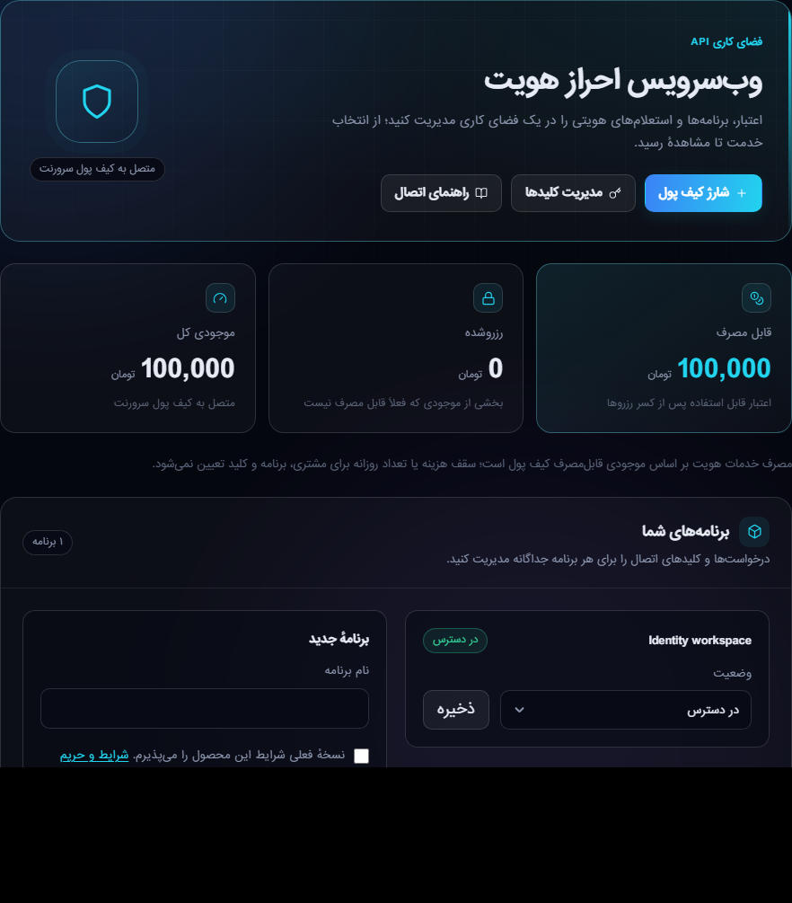
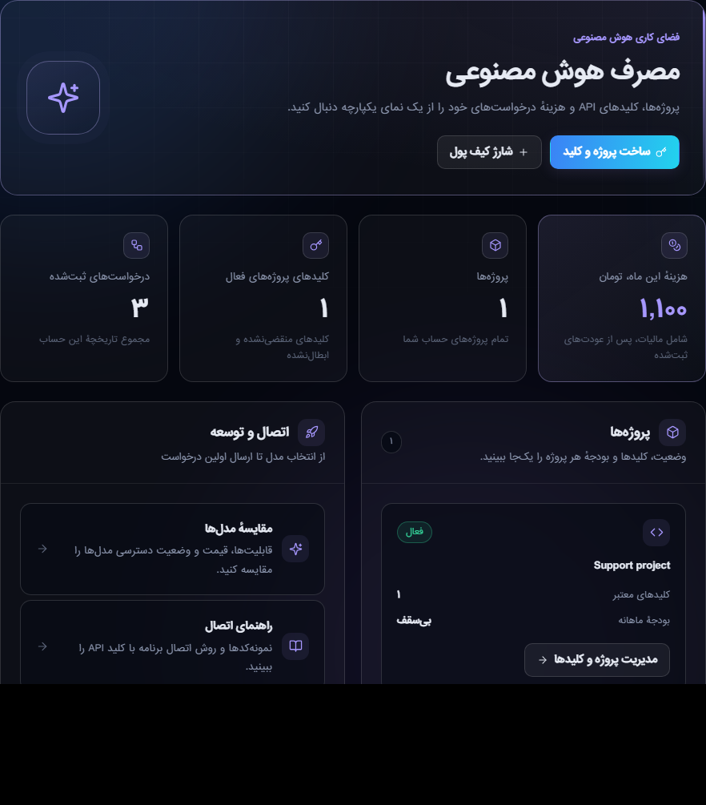

# بازطراحی داشبورد API مشتری — ۲۷ اکتبر ۲۰۲۶

## مسئله و نتیجه

مالک بازطراحی دو مسیر `/account/identity-api` و `/account/ai` را برای رابط حرفه‌ای، خلاقانه و کاربرپسند خواست. مبنای اولیه `fe88498f` از develop بود. دو view فعال پیش از تغییر با نسخهٔ Git مبنا یکسان بودند؛ شش فایل ترجمهٔ فعال جداگانه فقط‌خواندنی دریافت شدند. دسترسی خواندنی cPanel با مجوز قبلی مالک برقرار بود؛ اتصال مرورگر این نوبت و کنترل پنجره در دسترس نبودند، بنابراین بررسی بصری روی رندرهای محلی ساختگی انجام شد.

هر دو صفحه اکنون از CSS محدود `account-api.css` استفاده می‌کنند: سربرگ محصول، کارت آمار، اقدام‌های اصلی، وضعیت‌های رنگی و empty state؛ رنگ احراز هویت فیروزه‌ای و AI بنفش است. تم روشن/تیره، RTL/LTR، فوکوس و reduced motion پوشش دارند. جدول‌های پُر در محفظهٔ دارای فوکوس اسکرول می‌شوند؛ سابقهٔ خالی AI جدول افقی غیرضروری ندارد.

احراز هویت: اعتبار قابل‌استفاده، رزرو و موجودی کل در سه کارت؛ برنامه‌ها و ساخت برنامه؛ کاتالوگ گروه‌بندی‌شده با کارت خدمات و انتخاب GET؛ بخش مجزای استعلام با تفکیک قبل مالیات/مالیات/نهایی و تأیید صریح هزینه؛ محیط آزمایشی؛ سابقهٔ قابل فیلتر؛ کلیدها و تنظیمات جمع‌شونده. ۵۹ کلید همسان در هر زبان، شامل برچسب خوانا برای ۲۷ ورودی فعلی اضافه شدند؛ نام فنی کوچک و fallback برای ورودی آینده وجود دارد.

هوش مصنوعی: هزینهٔ ماه جاری پس از عودت ثبت‌شده، تعداد پروژه‌ها، کلیدهای معتبر در پروژه‌های فعال و تعداد کل رسیدها از داده‌های موجود نمایش داده می‌شوند. کارت پروژه، وضعیت/بودجه و دسترسی به مدل‌ها/راهنمای اتصال واضح‌اند. ۲۴ کلید همسان در هر زبان اضافه شد. جمع صفحهٔ فعلی به‌عنوان مجموع حساب نمایش داده نمی‌شود.

هیچ controller، authorization، فرمول، واحد ذخیره، query مالی، migration، provider یا سیاست فروش تغییر نکرد. مقادیر استعلام، CSRF، idempotency_key، price_version، max_charge_irt، رضایت real_charge، وضعیت/لغو کلید و خالص/مالیات/عودت AI حفظ شدند. این صرفاً بهبود ارائه و متن‌های رابط است.

## آزمون واقعی

PHP 8.4.26 با vendor منطبق composer.lock و SQLite درون‌حافظه‌ای: **۱۲۹ تست، ۱۲۱۴ assertion، همگی موفق**. تست جدید AccountApiWorkspacePresentationTest: ۱۶/۳۵۱؛ تست‌های قبلی AiBillingDisplayTest، IdentityApiTest، IdentityProductPageTest و AiProjectsAndAdmissionTest: ۱۱۳/۸۶۳. GETهای واقعی سه زبان، حفظ فرم/نام ورودی/مبلغ/تفکیک مالیات، مالکیت، نام بلند escaped، pagination و نبود HTTP بیرونی پوشش دارند.

Chromium: **۶۲ حالت یکتا موفق**؛ دو صفحه × سه زبان × دو تم × عرض‌های۳۲۰،۳۹۰،۷۶۸،۱۴۴۰ برای حالت پُر؛ دوازده حالت خالی موبایل و دو حالت نام بلند انگلیسی AI. باز/بستن تنظیمات کلید و کاتالوگ در هر چهار عرض بررسی شد؛ سرریز سند، ورودی بی‌برچسب و خطای JS صفر. شش حالت خالی AI پس از اصلاح نهایی CSS دوباره کنترل شدند و اسکرول افقی محفظه هم صفر بود. تصاویر فارسی موبایل/دسکتاپ مستقل بازبینی شدند. خطای Blade موقتی پس از افزودن برچسب‌ها پیش از انتشار رفع شد؛ کل مجموعه پس از رفع دوباره سبز شد.

lint شش ترجمه، PHP ابزار پذیرش و git diff --check موفق‌اند. هیچ حساب مشتری، شارژ، استعلام واقعی، ساخت/لغو کلید یا درخواست پولی AI برای QA انجام نشد.

## انتشار و بازگشت

**سورس در develop ثبت شده است؛ نصب فعال تولید هنوز انجام و تأیید نشده است.** سورس: `e659e7b90d5baae8cb9906097a409f40634e7d1d`. اتصال محیط اجرا پس از ایجاد job موقت آماده‌سازی قطع شد؛ نتیجهٔ آماده‌سازی و پاک‌سازی job هنوز بررسی نشده‌اند.

ابزار `scripts/deploy-account-api-workspaces.py` از runner قبلی با hash ثابت استفاده می‌کند. ده مقصد: دو CSS، شش ترجمه، دو view. آماده‌سازی پیش‌فرض هیچ فایل فعالی را تغییر نمی‌دهد؛ اجرا صریح است. دو قفل انتشار، پشتیبان خصوصی، کنترل hash پیش/پس و کامپایل محدود دو view حفظ‌اند. ترجمه‌ها فقط بلوک تازه را با collision guard اضافه می‌کنند؛ viewها با hunk محدود نسبت به والد commit تغییر می‌کنند. عدم تطبیق موجب توقف است، نه بازنویسی اختلاف جدیدتر.

ابزار CLI-only `verify-account-api-workspaces.php` شش رندر با مدل‌های ساختگی ذخیره‌نشده و listener نوشتن SQL را می‌سنجد؛ هیچ عملیات محصول یا provider را صدا نمی‌زند. در نبود shell مرورگر، اجرای موقت helper از job محدود cPanel انجام و پس از هر مرحله فقط همان job برداشته می‌شود؛ ده job قبلی باید حفظ و دوباره تطبیق داده شوند. زمان‌بند Laravel برای آزمون دستی اجرا نمی‌شود و job دائمی محصول اضافه نخواهد شد.

برگشت فقط از پشتیبان همین release و در صورت تطبیق hash نسخهٔ نصب‌شده انجام شود. دو view ابتدا از نسخهٔ قبلی فعال شوند؛ CSS و کلیدهای ترجمهٔ تازه می‌توانند بدون ارجاع باقی بمانند. هیچ کش مشترکی پاک نشود.

## توقف محیط هنگام آماده‌سازی — ادامهٔ لازم

در این نوبت فقط پوشهٔ خصوصی `~/.servernet-ui-releases/account-api-tools-20261027-e659e7b9/` با permission۰۷۰۰ ایجاد شد و سه ابزار ثبت‌شده در Git در آن آپلود شدند. بایت هر سه ابزار دوباره خوانده و با SHA-256 مبدا تطبیق داده شد. سپس یک job موقت فقط برای اجرای پیش‌بررسی Python، با hash guard و ast.parse پیش از اجرای helper، اضافه شد. فرمان نصب `--execute` **صادر نشده است**. این job، زمان‌بند محصول/استعلام/مالی را اجرا نمی‌کند.

شناسهٔ release: `pending-request-ui-account-api-20261027-e659e7b9`. پیش از افزودن job، ده job موجود cPanel دیده شدند. در همین نقطه محیط ویندوز unavailable شد؛ اجرای shell محلی، Node و مرورگر هیچ‌کدام در دسترس نبودند. بنابراین نتیجهٔ `prepare.log`، manifest و `preflight-ok` هنوز معلوم نیست؛ job موقت نیز هنوز حذف و حفظ ده job قبلی دوباره تأیید نشده است. در اجرای تکراری، runner از stage موجود عبور نمی‌کند و فایل فعال را نمی‌نویسد.

اولین اقدام پس از بازگشت اتصال: از Cron API2، فهرست تازه خوانده شود؛ فقط job دارای مسیر اختصاصی `account-api-tools-20261027-e659e7b9` و همین release شناسایی و با موقعیت فعلی حذف شود. بلافاصله فهرست بعدی با سایر سطرهای فهرست قبل مقایسه شود؛ سطر قدیمی یا شمارهٔ حفظ‌شده مبنای حذف نباشد. سپس `prepare.log` و محتویات release خصوصی بررسی شوند. helper آماده‌سازی کورکورانه دوباره اجرا نشود. اگر preflight موفق بود، اجرای صریح guard‌شده، تأیید ده hash و رندر CLI خواندنی شش حالت انجام شود؛ job موقت اجرای این مرحله هم پاک و زمان‌بندی قبلی حفظ شود.

تصاویر ساختگی بازبینی‌شده، نه حساب زندهٔ مشتری:

