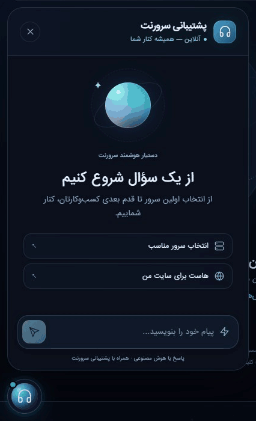

# بازطراحی چت پشتیبانی — ۱۸ اکتبر ۲۰۲۶

وضعیت: **در سایت اصلی منتشر و بررسی شد**. درخواست مالک، تطبیق طرح گوی متحرک پیوست با چت موجود، فارسی راست‌چین با فونت اصلی سایت و انگلیسی چپ‌چین بود. متن پیوست مرجع طراحی است؛ دستورهای React/shadcn/Unsplash آن با ساختار واقعی Laravel تطبیق داده شدند. React یا وابستگی تازه به سایت تحمیل نشد.

## تحویل به توسعه‌دهندگان در develop

این تغییر به درخواست مالک مستقیماً برای `develop` آماده شد؛ مبنای Git `a688add4280429dcb33cf01a31e991fadc6ca083` است. از checkout ایزوله استفاده شد تا تغییرهای متعدد محل کار اصلی وارد این کامیت نشوند. فایل‌های تازه چت، اتصال محدود قالب/اسکریپت، تست‌های مستقل و همین گزارش، محدودهٔ تحویل‌اند. کامیت Git نصب مجدد روی تولید اجرا نمی‌کند؛ وضعیت نصب بالا مربوط به پذیرش واقعی قبلی است.

پیش از ارسال، توسعهٔ هم‌زمان تیم تا `c45af3a28aa22e047a7613b043074a5667cd036a` دریافت و تغییر چت روی آن بازچینی شد؛ یادداشت‌های هر دو کار در نمایه‌ها حفظ شدند. تفاوت کد چت با نسخهٔ تولید در این همگام‌سازی ایجاد نشد.

نکتهٔ نگهداری: `chat-morph.js` پیش از `site.js` با `defer` بار می‌شود و با `data-morph-ready` از اتصال هم‌زمان دو handler جلوگیری می‌کند. هنگام تغییر assetها این ترتیب حفظ شود. ترجمه‌های تازه در `lang/{fa,en,tr}/chat.php` مستقل از `ui.php` هستند. CSS جدید بعد از CSS عمومی اضافه می‌شود؛ تغییر در `site.min.css` برای این طرح لازم نیست.

این پیش‌نمایش، ضبط واقعی همان سایت از پیام «سلام» تا پاسخ است:



## نتیجه

- صفحه شروع با گوی نورانی، عنوان و دو پیشنهاد سؤال؛ پیشنهادها پیام واقعی به همان endpoint قبلی می‌فرستند.
- کادر پیام هنگام انتظار جمع می‌شود و گوی متحرک همراه برچسب‌های انتظار نمایش داده می‌شود. وضعیت پایان پس از دریافت پاسخ واقعی ظاهر می‌شود؛ ادعای اجرای جستجو یا ابزار ساخته نشده است.
- فارسی RTL، انگلیسی/ترکی LTR؛ ورودی خالی جهت زبان صفحه را دارد، ورودی دارای متن و حباب‌ها `dir=auto` دارند. فونت واقعی `IRANSans` از `--font-body` سایت است.
- تاریخچه در همان صفحه هنگام بستن/بازکردن حفظ می‌شود؛ همان کلید `sn_chat_sid` برای حافظه سمت سرور باقی است. محدودیت ۱۰۰۰ کاراکتر، CSRF، endpoint و بک‌اند تغییر نکردند.
- ارسال هم‌زمان مهار می‌شود؛ پاسخ خالی/خطای HTTP یا timeout، خطای قابل‌فهم و تلاش دوباره با همان پیام و session دارد. مهلت مرورگر ۶۵ ثانیه است. متن پاسخ با `textContent` و لینک‌ها با پروتکل مجاز درج می‌شوند.
- فوکوس، Escape، `inert` برای چت بسته، اعلان وضعیت، حالت کاهش حرکت، تم روشن و نمایش موبایل رعایت شده‌اند. پاسخ دیرهنگام پس از بستن چت، فوکوس را نمی‌رباید.

## دامنه انتشار و پایداری

فقط میزبان وب و هفت فایل:

1. `public_html/assets/css/chat-morph.css` (جدید)
2. `public_html/assets/js/chat-morph.js` (جدید)
3. `servernet_app/lang/fa/chat.php` (جدید)
4. `servernet_app/lang/en/chat.php` (جدید)
5. `servernet_app/lang/tr/chat.php` (جدید)
6. `public_html/assets/js/site.js` (سه تغییر محدود برای جلوگیری از handler تکراری و fallback قابل‌دسترسی)
7. `servernet_app/resources/views/partials/chat.blade.php`

ابتدا state زنده خوانده شد: hash قالب پیشین با blob اصلی Git برابر بود؛ JS زنده مستقل از فایل محلی دریافت شد. تغییرهای قبلی و هم‌زمان `site.js` محلی با آپلود کامل جایگزین نشدند؛ نسخه زنده با سه جایگزینی دقیق تک‌تطبیق اصلاح شد. نصب assetها و ترجمه‌ها قبل از اتصال قالب انجام شد. route، کنترلر چت، دیتابیس، n8n، قیمت، سفارش، خدمات، ماشین‌های مجازی، NAT/firewall، DNS، cron و state عامل‌های شبکه تغییر نکردند.

بسته خصوصی سرور: `/home/servernetcloud/chat-morph-20261018-v1` شامل before/after، manifest و رسید `applied.json`. ابزار محدود: `/home/servernetcloud/deploy-chat-morph-20261018-v1.py`. ساخت بسته در منبع: `scripts/build-chat-morph-release.cjs`. خروجی‌های محلی زیر `output/chat-morph-20261018` هستند؛ URL نشست cPanel و secret در گزارش ثبت نشده‌اند.

نسخهٔ Git ابزار ساخت، snapshot پیش از انتشار را با SHA ثابت بالا می‌خواند؛ اجرای آن فقط فایل محلی تولید می‌کند و به سرور وصل نمی‌شود. این ابزار تاریخی برای بازسازی بستهٔ همین انتشار است؛ انتشار نسخه‌های بعدی نیاز به snapshot و manifest تازه دارد. فایل‌های تولیدشدهٔ output و اطلاعات نشست به Git افزوده نشده‌اند.

ابزار stage هر هفت مسیر را با hash یا عدم‌وجود مورد انتظار بررسی، پشتیبان تهیه و PHP ترجمه‌ها/Blade کامپایل‌شده را lint کرد. apply دوباره hashها را سنجید، نوشتن اتمیک انجام داد و `view:clear` موفق شد. مسیر رسمی `/system/opcache` با credential موجود در همان سرور، بدون نمایش آن، HTTP200 و `opcache_reset=true` داد؛ پاک‌شدن config/route/view/cache گزارش شد. تنظیم پایداری جداگانه لازم نیست؛ assetها و قالب در مسیر اصلی فعال‌اند.

## اعتبارسنجی

- پنج تست رفتاری Node/jsdom موفق: تک‌درخواست با handler قدیمی، انتظار/پاسخ واقعی و لینک امن؛ خطا و تلاش دوباره با session یکسان؛ حفظ فوکوس و تاریخچه پس از بستن؛ سه زبان/جهت خودکار؛ پاسخ خالی و پیشنهاد سؤال.
- هر سه ترجمه PHP lint موفق و قالب واقعی با Blade در هر سه زبان رندر شد. بررسی syntax هر دو JS و `git diff --check` موفق بود.
- HTML عمومی fa/en/tr هر سه HTTP200 و اتصال assetها/برچسب محلی صحیح داشتند. hash دریافت‌شده عمومی CSS جدید، JS جدید و `site.js` با manifest نصب برابر بود.
- مرورگر سایت واقعی: پیام فارسی «سلام» ارسال و پاسخ «سلام! چطور می‌توانم به شما کمک کنم؟» دریافت شد؛ phase به idle برگشت و هیچ خطای کنسول ثبت نشد. این تست، سلامت تمام پاسخ‌های هوش مصنوعی یا تمام مسیرهای پشتیبانی را اثبات نمی‌کند.
- فارسی و انگلیسی در عرض۳۹۰، فونت اصلی و جهت صحیح ورودی تأیید شدند؛ فارسی زنده pageWidth=375 و viewport=390 بود و سرریز افقی نداشت. ترکی زنده، برچسب‌ها و LTR صحیح و بدون خطای کنسول بود. تم روشن در fixture محلی با همان assetها بصری بررسی شد.
- تصاویر: `output/chat-morph-20261018/live-fa-mobile.png`، `live-en-mobile.png` و `live-thinking.png`. پاسخ‌های fixture صرفاً نمایشی‌اند و به سایت منتقل نشده‌اند.

اجرای تست قابل تکرار، با PHP۸٫۴، وابستگی‌های Composer نصب‌شدهٔ اپ و Node۲۲؛ بستهٔ مستقل آزمون jsdom۲۶٫۱ را قفل می‌کند و وابستگی runtime سایت را تغییر نمی‌دهد:

```powershell
$env:PHP_BINARY = 'PATH_TO_PHP_84'
cd website/tests/js
npm ci --ignore-scripts --no-audit --no-fund
npm run test:chat
```

بازآزمایی تحویل Git در checkout ایزوله: پنج تست رفتاری موفق؛ PHP ترجمه‌ها و fixture معتبر؛ JSها بدون خطای syntax؛ بازسازی بسته و برابر بودن هفت after-hash با manifest انتشار قبلی بررسی شد. Composer vendor توسعهٔ محلی فقط برای BladeCompiler fixture خوانده شد؛ برنامه، دیتابیس یا config تولید boot نشدند. suite کامل PHP در این تغییر نمایشی اجرا نشده است.

## بازگشت محدود

ابزار نصب‌شده را کورکورانه stage/apply نکنید؛ وجود پوشه/رسید مانع اجراست. برای بازگشت، ابتدا تغییرهای بعدی را بررسی کنید. دستور زیر فقط وقتی hash جاری هر هفت فایل برابر نسخه همین انتشار باشد اجرا می‌شود؛ قالب و JS قبلی را بازمی‌گرداند و فقط پنج فایل تازه همین بسته را حذف می‌کند:

```text
python3 /home/servernetcloud/deploy-chat-morph-20261018-v1.py rollback
```

سپس مسیر رسمی opcache با credential خصوصی موجود اجرا و fa/en/tr بازبینی شود. پس از تغییر هم‌زمان، guard متوقف می‌شود و ادغام دستی لازم است. هیچ restore عمومی پروژه، deployment helper قدیمی یا تغییر بک‌اند برای این بازگشت لازم نیست.
