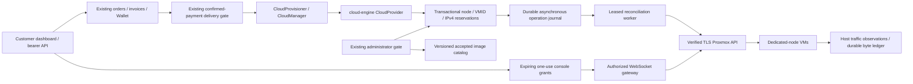

# ServerNet Cloud Engine architecture

Status: design recorded before implementation, 2026-11-03. Base: `develop`
`dddea6407d52c44bd0c0853a1bb148235ea11e17`. No production deployment or
hardware purchase is authorized by this document. Hardware acceptance remains
separate from simulated software acceptance.

## Existing system audit

The active application is `website/`, Laravel 13/PHP 8.4. The registry in
`CloudManager` implements `CloudProvider` for Hetzner Cloud, Hetzner Robot,
Proxmox and other suppliers. `CloudStoreController` creates existing Service and
Invoice records; `PaymentService::applyPaid`, Wallet and `provision:run` govern
payment and delivery. `CloudProvisioner` claims services atomically, records a
CloudInstance before remote calls, uses deterministic `sn-svc-{id}` names and
owns delivery, reconciliation, notices, suspension, release and compensation.
Existing monetary amounts remain integer IRT (Iranian Tomans). No new wallet,
invoice system, renewal clock or automatic customer migration is introduced.

`ProxmoxClient` is an existing single-settings Iran/exit adapter. Its current
scan-based private IPv4 allocation, unchecked task outcomes, TLS verification
override and stub console/metrics cannot be the new platform's safety boundary.
It remains unchanged for existing customers. Robot manages physical rentals;
deleting a VM must never call Robot's physical cancellation method.

The existing Ansible inventory targets real Iran infrastructure and protected
guests. The new dedicated-node tooling uses a separate inventory and explicit
operator-supplied configuration. Existing Linux template roles cover the six
requested Linux distributions but use moving download URLs without checksum
evidence. Windows staging is not a licensed, tested Windows image factory.

Existing bearer API authentication is `CustomerApiToken`: hashed, expiring and
revocable tokens, abilities, IP restrictions and active customer checks. Its
`api_customer` identity is separate from the browser customer guard. New API
controllers must authorize that explicit customer and serialize a public DTO;
returning raw CloudInstance `meta` is prohibited.

## Components and boundaries

The new namespace is `App\Services\Cloud\Engine`; the provider slug is
`cloud-engine`. Existing providers remain available. New sales default disabled
until explicit node/image acceptance and capacity configuration. Product/node
eligibility is configurable, never a hardcoded single host. Existing CloudPlan,
CloudImage, CloudLocation, Service and CloudInstance remain customer/business
records; engine tables hold infrastructure state only.

## Persistence contract

Additive migrations only; do not rewrite historical migrations or billing models.
Engine models use the `cloud_engine_` table prefix, with these responsibilities:

* Node inventory: endpoint, Proxmox node, encrypted/hidden API token, location,
  storage/bridge/gateway, management trust, health freshness, drain/sales state,
  CPU/RAM/disk capacity and safety reserves, VMID allocation range.
* Images and plan/node mappings: exact local template VMID per node, family,
  version, architecture, checksum/source evidence, initialization acceptance and
  license acceptance. Windows is unavailable until licensing and initialization
  evidence exists.
* Subnets and addresses: explicit routed IPv4 prefixes, gateway, node eligibility,
  globally unique addresses, reserved/allocated/quarantined/free states and
  append-only allocation history. Imports are bounded and exclude network,
  broadcast and gateway addresses. No subnet-wide deletion endpoint.
* VM reservations: unique service, unique `(node_id, vmid)`, unique active address,
  deterministic name and exact reserved CPU/RAM/disk/image. Reservations survive
  timeouts and process restarts.
* Operations: unique idempotency key, action/input fingerprint, VM/service,
  durable phase, task receipt, lease/attempt/deadline, structured error code,
  reconciliation state and audit history. Reuse `CloudProviderOperation` for the
  existing provider boundary where appropriate; infrastructure phase records are
  not a billing ledger.
* Traffic: integer inbound/outbound byte observations, counter epoch/sequence,
  sampled UTC timestamps, idempotent deltas and calendar-month aggregates.
* Console: hashed opaque one-use grant, service/customer identity snapshot,
  expiration and atomic claim. Credentials/task IDs/internal endpoints are hidden.

Placement locks candidate nodes in stable order, checks fresh healthy/not-draining
state, accepted image and product mapping, then reserves capacity, VMID and one IP
inside the same database transaction. Unique constraints are the final duplicate
guard. SQLite tests alone do not prove MariaDB concurrency behavior.

## Remote operation and recovery contract

The API never performs unbounded provisioning in an HTTP request. Existing paid
delivery creates a reservation/operation and returns building state. A worker
claims a bounded lease and advances persisted phases. Each mutation is recorded
before submission. A missing HTTP response means unknown outcome, not failure to
create. Reconcile exact node/VMID and ownership marker before retrying. A VM with
the reserved ID but a different identity marker is quarantined, never adopted or
deleted. A lost clone response must not produce a second VM or release its IP.

Clone, configure CPU/RAM/disk/cloud-init/firewall, start and verify must each have
observable success. Proxmox asynchronous UPID completion requires both stopped
status and `exitstatus=OK`; timeout is pending/uncertain. Initial credentials are
encrypted and exposed only through existing ownership/one-time password rules.
Credential reset requires a supported guest-agent/initialization mechanism; a
cloud-init configuration write alone is not proof that a running guest changed.

Deletion marks intent, verifies VM ownership, stops/deletes through supported APIs,
then verifies authoritative absence and network/console dependencies before IP
release. Ambiguous errors, 401/403, timeouts and disconnected nodes retain all
reservations. Rebuild retains the same service/IP and has an explicit destructive
confirmation. Rescue, migration, snapshots and rDNS report unsupported until
their individual implementation and acceptance evidence exists.

## API, administrator and console contracts

Versioned server endpoints follow existing `/api/v1` bearer conventions, scoped
server abilities, throttling, ownership and explicit DTOs. `POST /servers` binds
an existing confirmed-paid service; it must not let callers turn an arbitrary
unpaid service into a provisioning job. New orders continue through existing
checkout/payment flows. Replayed idempotency keys return the same operation;
reuse with different inputs returns conflict. All mutation endpoints return an
operation resource and never raw provider errors.

Administrator inventory uses existing admin middleware and the design system,
with Persian/English/Turkish labels. Node health/capacity, sales/drain controls,
VM/IP inventory, image acceptance, failed jobs and retries are explicit. Existing
provider selection remains operational; engine sales are an opt-in addition.

Console connections require ownership at issue, redemption and gateway connect,
short expiration, one-use atomic claim and service/node state revalidation.
The browser receives only an opaque gateway token/URL. The gateway retains PVE
API tokens/tickets, validates TLS and Origin, forwards only the bound VM's socket,
enforces expiry and never exposes an administrator password or arbitrary proxy.

## Traffic, capacity and commercial acceptance

RRD rates are monitoring data, not billing truth. Collect per-VM virtual-interface
counters on the host with a persistent epoch/sequence and authenticated ingestion.
Inbound means bytes delivered to the guest; outbound means bytes leaving it.
Count one observation point, never both bridge and tap. Detect decreases/reboots,
reject duplicate/out-of-order observations and record coverage gaps rather than
invent usage. Month boundaries use UTC and must not silently attribute an unknown
cross-boundary interval. Define decimal GB as 1,000,000,000 bytes and GiB as
1,073,741,824 bytes. Alerts/reports use these exact units. No automatic monetary
overage charging is introduced.

Capacity models reserve host overhead and RAM/storage rather than assuming
aggressive overcommit; CPU/IOPS/network/traffic remain independent bottlenecks.
Commercial calculations include rental, IPv4/setup, VAT, backup, traffic, fees,
FX and occupancy. The target is **1,000,000 IRT per month**, not 1,000,000 IRR.
Pricing/specifications must be dated and sourced; absent current quotations are
explicit inputs, not invented supplier offers.

## Implemented release scope and open gates

The first release is monthly VPS only. Existing Wallet/invoice settlement and
renewal remain authoritative; both the PHP capability method and SQL catalog
scope reject engine hourly offers, and the paid gate rejects forged hourly
records. The synchronous hourly credit hold/resume path needs a separate
asynchronous billing integration before it is safe to expose this provider.

The implementation includes a real customer session interface and separate
scoped bearer API, administrator inventory/acceptance controls, observed metrics,
exact traffic reports and a credential-hiding console gateway. Disk allocation
is distinct from guest filesystem use, which is explicitly unmeasured. Boot time
is an estimate derived from observed uptime. Initial quotas are snapshotted from
the existing plan's decimal-GB allowance; threshold alerts never charge money.

Routed-bridge guest addresses use their assigned subnet prefix and its internal
host-owned gateway; NIC IP filtering and host/VM firewall candidates are part of
admission. Windows requires a licensed, accepted template, verified guest agent
and fresh trusted firstboot receipt. Its PowerShell implementation has not been
executed on Windows in this environment. Every candidate OS image remains
inactive until its artifact provenance and actual initialization are accepted.

Resize, additional public IPs, provider-side rDNS, cross-node IP migration,
snapshots and rescue are not advertised as implemented engine capabilities.
Console access uses the dedicated gateway service; the generic legacy adapter
URL method remains unavailable so it cannot leak an upstream credential URL.
Real host networking, per-image boots, console interoperability, generated TAP
traffic and off-node restore remain hardware acceptance work. This is a gated
candidate, not a claim of complete production or purchase readiness.

## Validation and release gates

Software simulation must cover paid gate, idempotency, concurrent allocation,
capacity exhaustion, node drain/disconnect, failed task/timeout/lost response,
safe compensation, deletion quarantine, cross-customer denial, console replay,
counter resets/duplicates/month boundaries, image validation and backup restore.
Run relevant existing suites and report baseline failures separately. Mocked
HTTP tests are not real Proxmox integration tests.

Separate dedicated-node tooling must provide hardware preflight, supported PVE
installation, routed subnet/bridge/firewall examples, least privilege token,
verified image import, backup/monitoring/restore, dry-run and rollback runbooks.
No script purchases or activates hardware. Stage A is development/simulation;
stages B-F require real node acceptance, internal orders, pilot and explicit
commercial approval. Existing customers are not automatically migrated, and
Hetzner Cloud remains available.

The hardware purchase gate is a machine-readable/manual checklist with evidence,
not a constant set to ready by tests. Missing real console/network/traffic/image
or restore acceptance stays outstanding. The one-working-day onboarding target
cannot be claimed until real hardware deployment and acceptance demonstrate it.
