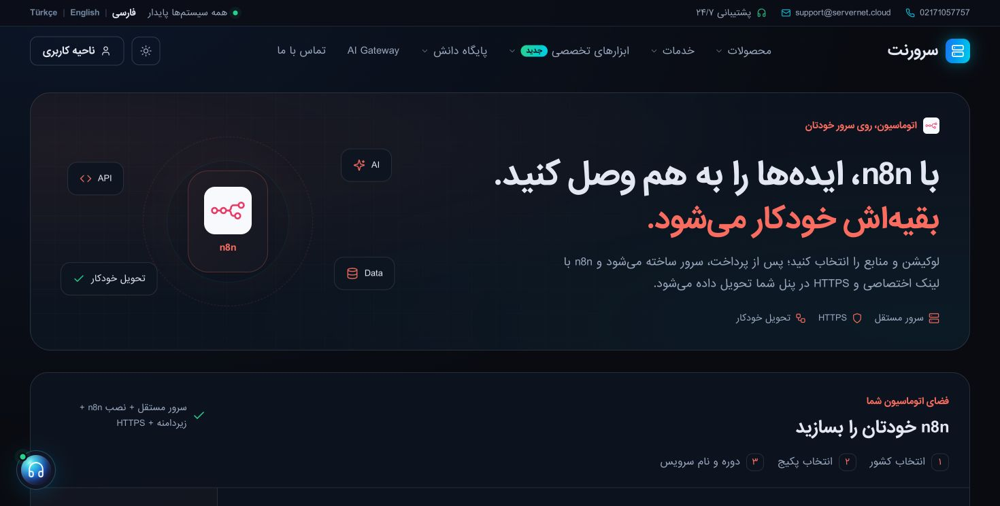

# Console and n8n workspace experience

Initial source base: `fc744ea4db7cb211da6daa8985cd4ec6e10d07ff`, `develop`.
Concurrent homepage, Studio and email changes were retained before publication.

The owner requested a full-width customer console, managed n8n under Services,
a country-first purchase flow, account security inside Profile, and a main-site
destination for the console header logo. This changes presentation and the
explicit owner password-reveal response, not prices or provisioning policy.

## Experience

- The account shell uses available width, a bounded scrollable desktop sidebar,
  the existing accessible mobile drawer, and a compact footer. Purchase and All
  leave the sidebar; their existing routes remain reachable. The account logo
  opens the main ServerNet site and preserves the selected language.
- Services provides n8n, AI and Identity API workspace entry points. Only the
  managed-application marker moves n8n into the Services presentation bucket.
  Its cloud identity, lifecycle, payments and ordinary VPS categorization stay
  intact. Acquired n8n cards show country flags, delivery state, HTTPS address,
  owner email, billing period and next renewal where applicable.
- Public and authenticated n8n pages share a progressive configurator: country,
  available package, then period and service name, with a server-priced summary.
  Links and forms work without JavaScript. Guest choices survive the existing
  sign-in redirect; account checkout still requires explicit submission.
  Country changes clear the old package. Turkish packages never enable hourly
  billing. The normal backend validates and recomputes every order.
- Profile and verification gain a workspace hero and responsive information
  cards. Security is the Profile security tab (`?tab=security`); legacy security
  deep links and all existing OTP, TOTP, IP and token actions remain supported.
- Motion is confined to decorative hero elements and small transitions; reduced
  motion is respected. The existing fa/en/tr interface is fully translated.

## Private access

Normal GET never decrypts the initial n8n password. The existing authenticated,
CSRF-protected owner-only POST can now return JSON with `no-store, private`.
The card requests it only after an explicit reveal, renders it using
`textContent`, and masks it on page exit. Copy is a separate user action.
The existing single-use flash redirect remains the non-JavaScript fallback.
Cancelled services and another customer's service cannot reveal credentials.

## Validation

241 isolated PHP tests / 1499 assertions passed, including managed n8n, account
sections under test fixtures, profile/navigation, security/OTP/TOTP, API workspace,
provisioning, delivery, Proxmox and VPS.TC renewal/lifecycle behavior. Four
configurator JavaScript tests and three guarded release/rollback tests passed.
Both new JavaScript assets passed syntax checks. Five merged production-overlay
PHP candidates passed syntax checks separately.

A separate section/header regression run had three existing failures. All three
were reproduced unchanged on the clean source base: the crypto partial contains
an inline style block; two impersonation tests treat the homepage's harmless
`imp-bar` text as an active impersonation bar. They are not reported as passing.
The main release finished with all 25 GitHub checks passing. A subsequent
CSS-only mobile correction finished with all 16 applicable checks passing,
including Chromium navigation with ordinary and reduced motion. An additional
API workspace fixture run passed 16 tests / 351 assertions after fixing only
test data widths and generated price IDs for the MariaDB matrix.

## Limited release and rollback

The main immutable release manifest lists 33 exact destinations, including both independent asset
copies. Fifteen relevant views are compiled in both observed account-owned FPM
pools. Source and destination hashes, a private backup and the four existing
release locks protect installation. Only the n8n public page cache keys and
the affected scripts/compiled views are invalidated.

The reviewed production overlay preserves existing Arvan traffic context,
deployed wallet display behavior, panel-head stack and birthday visibility,
public CSS behavior, Iranian menu visibility and full-width console header.
The site layout's deployed CRLF convention is preserved. These differences are
not silently replaced by unrelated newer repository behavior.

No schema change, migration, provider purchase, VM creation, real checkout,
customer debit or security-setting change is part of acceptance. The Iranian
purchase identity gate and existing delivery automation remain in place.
Rollback restores only exact prior manifest bytes and refuses newer operator
work; it does not revert transactions or alter existing customer VMs.

## Production acceptance — 23 November 2026

Status: installed, activated and verified on both production FPM pools; live
desktop and mobile acceptance completed.

| Release | Source | Merge | Installed destinations |
| --- | --- | --- | --- |
| Main UI, [PR 405](https://github.com/servernetir/server/pull/405) | `610f83cdc889d2ead8ff518bc62060e1553a9d6a` runtime, `4401c53e2b17108429bce44fa8b8cea68b1d2524` final head | `430242e476cd063d58f470722d817aa7e77db0ba` | 33 |
| Mobile drawer, [PR 409](https://github.com/servernetir/server/pull/409) | `d2c9e6f76b91618e1d03d1f400f5711ff0ff7e15` | `168a3aa0e7a546f8dc6e70c0cf8745eac6f508f4` | 2 CSS copies |

The main final head differs from the installed runtime source only in the
MariaDB test fixture corrections; all runtime bytes are identical. Each release
completed apply, activate and verify with exit status zero. Each compiled the
15 affected views in both account-owned pools. Private backups and receipts
remain in their source-specific release stages.

The mobile follow-up removes the console wrapper stacking context that painted
the header above the drawer close control. Its two-file manifest supersedes the
main CSS destinations only. The full 33-file manifest remains available at the
immutable main source above. Roll back the follow-up before the main release;
hash guards still refuse subsequent operator changes. Chromium tests now load
the real console stylesheet and verify the drawer above a fixed header.

Live browser checks:

- The Services page fills the available console width without horizontal
  overflow. Purchase, All and Security are absent from the sidebar. n8n, AI and
  Identity API have workspace entry cards.
- Profile and verification show the new information cards. Clicking the
  Security tab opens the existing controls inside Profile. No security option
  was changed and no OTP was sent.
- Clicking the actual console header logo navigated to `https://servernet.cloud/`.
- Public Persian, English and Turkish n8n pages render translated content. The
  Persian country selector includes Iran, Germany and Turkey; the other public
  locales preserve the existing Germany/Turkey eligibility policy.
- Selecting Germany, a package, a yearly period and a sample name updated the
  summary. Clicking the public GET Continue transferred the exact package,
  period and name to the authenticated account wizard. Its order action remains
  POST and was not submitted.
- Hourly selection worked for Iran in the verified account wizard and Germany
  in the public wizard. Switching to Turkey cleared the earlier package and
  hid/disabled hourly selection. The default Turkish period was monthly.
- Mobile public layout and the customer Services page have no horizontal
  overflow. The mobile drawer opens above the header and closes normally after
  the follow-up; production wrapper isolation is `auto`. The viewport was reset.
- No public configurator JavaScript errors were reported in the inspected log.

The inspected real account has no acquired managed-n8n service. Ready, pending,
stopped and credential-reveal card cases were validated with isolated fixtures;
this UI acceptance did not place another paid order or expose a real password.
The previous provisioning acceptance is documented separately in
[automatic n8n delivery](N8N-AUTOMATIC-DELIVERY-2026-11-23.md).

Only the public, non-personal page is retained as a visual artifact:

Image SHA-256: `099cd29537de1312c89ffbbf6ca39fb86ea0329a2070b018f1ddca61c77b4221`.
Authenticated profile screenshots and personal account data were not retained.
