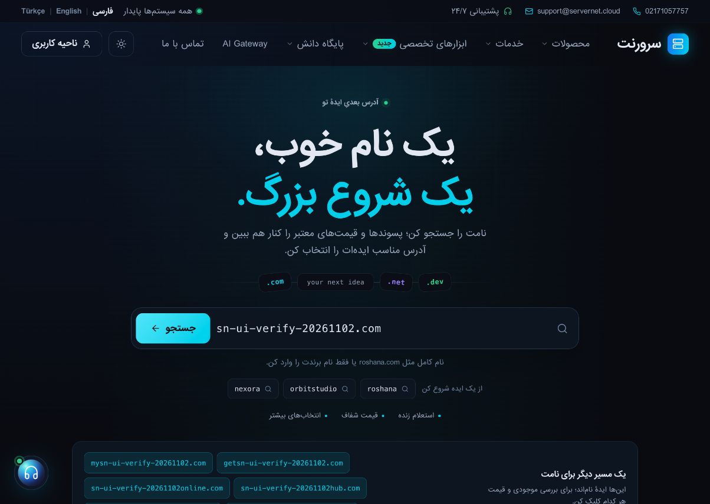

# انتشار رابط دامنه — ۲ نوامبر ۲۰۲۶

وضعیت: **در تولید تأیید شد**. ظاهر صفحهٔ دامنه و بخش دامنهٔ خانه، طبق درخواست مالک، مستقل از فعال‌سازی رجیسترار جدید منتشر شد. مبنای آغاز `1d08a1d32821d047c34aae3c86ef369aa51e207c`؛ کد نهایی آزموده‌شده `b0d615e6c1c6d95dbac3a399c31f44ff93ff75ba` و ادغام runtime در develop برابر `c3cceb20b5b4865f0b40835aa233f309bbd16184` است. ثبت بعدی فقط رسید و تصویر است.

[صفحهٔ دامنه](https://servernet.cloud/domains) · [صفحهٔ اصلی](https://servernet.cloud/) · [Manifest و رسید دقیق](domain-discovery-live-release-20261102.json)

## رفتار منتشرشده

صفحهٔ `/domains` طراحی سه‌زبانه، انیمیشن سبک، کارت موبایل، نتیجهٔ اصلی سنجاق‌شده، نام مشابهٔ بررسی‌نشده، فیلتر و بارگذاری دسته‌ای دارد. بار نخست یک دسته خوانده می‌شود؛ هر کلیک روی «پسوندهای بیشتر» فقط یک دستهٔ دیگر اضافه می‌کند. درخواست قدیمی نمی‌تواند جستجوی تازه را بازنویسی کند. شش ایدهٔ ASCII به‌صورت محلی ساخته می‌شوند و موجودی/قیمت فقط با انتخاب کاربر بررسی می‌شود؛ IDN/punycode دست‌کاری نمی‌شود.

خانه دکمهٔ «دامنه‌های پیشنهادی» را در کنار خرید نشان می‌دهد؛ query دقیق با پسوند در لینک باقی می‌ماند. قرارداد و `cart_url` رجیسترار فعلی حفظ شده‌اند. اسکریپت و شناسه‌های مستقل، ارسال دوبارهٔ فرم توسط اسکریپت قدیمی را متوقف می‌کنند. اگر پاسخ فعلی شاهد تخفیف نداشته باشد، فیلتر/شمارندهٔ آن پنهان می‌شود و قیمت خط‌خورده ساخته نمی‌شود. دورهٔ ثبت فقط از `period_years` یا `min_years` معتبر نشان داده می‌شود؛ پاسخ قدیمیِ فاقد مدت، فقط واحد پول دارد و یک‌ساله فرض نمی‌شود.

## نقشهٔ فایل‌ها و نصب

| منبع در `website/` | مقصد نسبت به home |
|---|---|
| `resources/views/pages/domain-search.blade.php` | `servernet_app/resources/views/pages/domain-search.blade.php` |
| `resources/views/pages/home.blade.php` | همان مسیر زیر `servernet_app`؛ فقط بخش دامنه وصله شد |
| `lang/{fa,en,tr}/domain-discovery.php` | همان سه مسیر زیر `servernet_app` |
| `public/assets/js/domain-home-discovery.js` | `servernet_app/public/assets/js/…` و `public_html/assets/js/…` |
| `public/assets/css/domain-home-discovery.css` | `servernet_app/public/assets/css/…` و `public_html/assets/css/…` |

هفت منبع، ۹ مقصد نصب دارد. محافظ‌های زندهٔ `IranSalesVisibility` بیرون از بخش دامنهٔ خانه حفظ شدند؛ کاندید زندهٔ خانه به همین دلیل با فایل خام Git تفاوت حساب‌شده دارد. هیچ controller، service، route، config، migration، زمان‌بند یا فایل مشترک `site.js`/`site.css`/`site.min.css`/layout از این بسته نصب نشد. دارایی تازه فقط در خانه بارگذاری می‌شود؛ هش‌های ورودی بهینه‌سازی سایر صفحات حفظ‌اند. [PR۲۱۷](https://github.com/servernetir/server/pull/217) رابط را جدا کرد؛ [PR۲۱۹](https://github.com/servernetir/server/pull/219) هش خام، [PR۲۲۰](https://github.com/servernetir/server/pull/220) حفظ mode و [PR۲۲۳](https://github.com/servernetir/server/pull/223) دورهٔ معتبر/نوشتن فایل تغییرکرده را تکمیل کردند.

## شواهد واقعی

[CI نهایی](https://github.com/servernetir/server/actions/runs/41493763540)، job `125443233712`: PHP۸٫۴؛ رندر واقعی Blade خانه و دامنه در fa/en/tr؛ lint ترجمه/ابزار؛ **۱۹تست رابط،۵۰بررسی native انتشار/بازگشت و۴بررسی محدوده موفق**. هر پنج workflow همین runtime موفق شدند. تمرین انتشار در فایل‌های ساختگی و بدون مسیر تولید اجرا شد؛ نبود PHP محلی با حذف محافظ bootstrap پوشانده نشد.

روی خود سرور نیز پنج lint خصوصی شامل دو خروجی Blade و سه ترجمه موفق شد. در نصب اول، هر ۹ مقصد و دو compiled view کنترل و نصب شدند؛ در اصلاح نهایی فقط یک view و compiled همان view نوشته شد. هشت مقصد یکسان و compiled خانه، بایت/mode/mtime خود را حفظ کردند. قبل و بعد از نصب، هش و mode تمام ۹ مقصد/دو compiled و هش هفت فایل محافظت‌شده بررسی شد؛ UID حساب۱۰۲۰، mode خانه۰۶۴۴/دامنه۰۶۰۰ و compiled موجود۰۷۵۵ حفظ شدند.

پذیرش تولید با query مخصوص BYPASS انجام شد: هر شش URL خانه/دامنه در fa/en/tr پاسخ۲۰۰ و متن ترجمه‌شده دارند. جستجوی واقعی در خانه، قیمت/آزادی، لینک پیشنهاد با FQDN کامل و مسیر مقصد تأیید شد. صفحهٔ دامنه ابتدا۱۰نتیجه و۶ایده نشان داد؛ کلیک «بیشتر» آن را به۲۰نتیجه رساند. کنسول مرورگر خطا نداشت. در موبایل، viewport واقعی CSS برابر۳۹۰×۸۴۴، scrollWidth۳۹۰ و عرض فرم۳۵۰ بود؛ سرریز افقی دیده نشد و viewport آزمایشی بازنشانی شد. فارسی RTL و انگلیسی/ترکی LTR بررسی شدند.

یک probe بدون نسخهٔ asset مشترک به‌طور گذرا۵۰۳ داد؛ URL واقعیِ نسخه‌دارِ همان JS/CSS که صفحه مصرف می‌کند،۲۰۰ و هش قبلی داشت و کنسول صفحه خطا نداشت. این probe شکست‌خورده به‌عنوان پاس حساب نشده است.

[تصویر بررسی موبایل](images/domain-discovery-live-mobile-20261102.jpg)؛ تصویر موبایل از viewport CSS۳۹۰ است، نه ادعای عرض فیزیکی فایل تصویر.

## کنترل انتشار و موارد اصلاح‌شده

Fileman هنگام خواندن متن HTML/CSS، charset metadata را تغییر می‌داد؛ یک برچسب۲۲بایتی به پاسخِ خواندن دامنه/CSS اضافه و برچسب charset از پاسخِ خواندن launcher حذف می‌شد. این پاسخ‌ها هش خام تولید نبودند. تشخیص auth‌شدهٔ محدود، هش خام `hash_file`/size/mode/UID را فقط برای مسیرهای ثابت گرفت. اختلاف CSS دقیقاً به همان۲۲بایت محدود و بازسازی آن با هش خام یکسان شد؛ فایل مشترک بازنویسی نشد.

پیش‌بررسی اول با `protected_file_drift` متوقف شد. پس از تطبیق خام، preview/lint موفق شد، اما apply با `invalid_compiled_state` پیش از هر نوشتن source متوقف شد: compiledهای قدیمی۰۷۵۵ بودند و validator اولیه آن را نمی‌پذیرفت. پذیرش محدودِ همان mode موجود با جلوگیری از گسترش مجوز و تست chmod-drift اصلاح شد. در QA زنده، فرض دورهٔ یک‌سال برای API قدیمی نیز اصلاح شد. رسید نهایی بالا پس از این اصلاحات است.

ابزار با نشست مدیر، `web/auth:web/admin` و CSRF اجرا شد؛ درخواست ناشناس۳۰۲ به ورود می‌رفت. engine/payload خصوصی و هش ثابت داشتند؛ سه قفل موجود انتشار، کنترل drift و جایگزینی اتمی هر فایل برقرار بود. ابتدا فقط پنج مسیر PHP/compiled و در اصلاح نهایی فقط compiled تغییرکرده هدف OPcache بودند. در هر مرحله فقط۱۲کلید PageCache همین دو صفحه در سه زبان باطل شد. reset یا flush عمومی، پاک‌کردن config/route و اجرای job مالی انجام نشد. پایان verify، backend/schema/config بدون تغییر و صفر تماس تأمین‌کننده از خود ابزار را ثبت کرد؛ تست جستجوی واقعی فقط خواندن موجودی/قیمت بود و پرداخت/خرید/ثبت/تمدید/انتقال انجام نشد.

هر پنج نام launcher عمومی پس از کار از webroot به stage خصوصی منتقل شدند و همه۴۰۴ دارند. کلید یا دسترسی SSH جدیدی ساخته نشد؛ مسیر ردشدهٔ جستجوی کلید SSH ادامه داده نشد. توکن API در گزارش/Git نیست. اتصال چندتأمین‌کننده و پذیرش نوشتنی Joker در [PR۱۸۳](https://github.com/servernetir/server/pull/183) مستقل باقی می‌مانند و این انتشار آن‌ها را فعال نمی‌کند.

## بازگشت

پشتیبان اول در `domain-ui-release-20261102-initial/before` و پشتیبان اصلاح نهایی در `domain-ui-release-20261102/before`، خارج webroot و خصوصی نگه داشته شدند. بازگشتِ اصلاح نهایی باید با همان manifest و کنترل هش/mode فعلی انجام شود؛ برای بازگشت کامل، پس از آن مرحله، stage اولیه با همان مسیر ثابت و payload خودش فعال می‌شود. تغییر تازهٔ ناشناخته یا chmod هم‌زمان، rollback را متوقف می‌کند؛ source و compiled قدیمی پیش از حذف وابستگی جدید برمی‌گردند. بازگردانی کل اپ، تغییر بانک اطلاعاتی و retry خرید از تأمین‌کنندهٔ دیگر جزو این بازگشت نیست.
