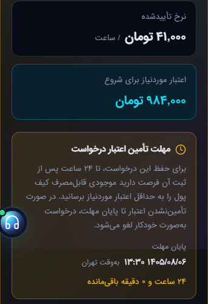

# مهلت تأمین اعتبار درخواست ساعتی GPU — ۲۷ اکتبر ۲۰۲۶

## رفتار و دامنه

درخواست مالک: درخواست پرداخت‌نشده مانند پیش‌فاکتور سفارش پس از همان مهلت لغو شود. مبنای توسعه `d8a143fda0e49ddaa3f53c8f213135e27890162e` از develop است. مقدار مؤثر قبلاً روی تولید فقط‌خواندنی بررسی شد: `billing.order_expiry_hours=24`؛ تنظیم عمومی سررسید فاکتور `invoice_hold_hours=48` سیاست دیگری است. کلاس مشترک OrderPaymentWindow برای فرمان پیش‌فاکتور سفارش و درخواست GPU از یک تنظیم استفاده می‌کند؛ override قبلی فرمان فاکتور حفظ می‌شود.

انقضا از requested_at اولیه، و در نبود تاریخ مطلق معتبر از created_at محاسبه می‌شود. تاریخ درخواست پس از ایجاد به زمان ایجاد محدود می‌شود. updated_at، بررسی ظرفیت و تأیید تعرفه مهلت را تمدید نمی‌کنند. در بررسی موعد، اعتبار قابل‌استفاده کیف پول باید حداقل HourlyStartCredit.minimum برای این سرور و تعهدهای ساعتی دیگر باشد. انتظار دارای اعتبار کافی، صرفاً به‌دلیل نبود ظرفیت منقضی نمی‌شود.

دامنه فقط درخواست مشتریِ مدیریت‌شده نسخه۱، Salad، ساعتی، awaiting_provision و gpu_wait/pending/running، تعرفه مثبت، بدون آغاز تخصیص، instance، فاکتور، برداشت ساعت اول، فعال‌سازی یا created_by است. درخواست منقضی به cancelled/none و علت payment_expired می‌رود و ActivityLog ثبت می‌شود. هیچ بدهی، برگشت اعتبار، power/delete یا خرید provider در مسیر انقضای این درخواست ایجاد نمی‌شود. مهلت ۱۲۰دقیقه‌ای تحویل پس از تخصیص و مسیر معمول فاکتورهای دوره‌ای حفظ می‌شوند.

قفل مشتری سپس سرویس تازه، تطبیق مالک، بازبینی انقضا پس از تماس ظرفیت و ثبت allocation_started_at در همان قفل، برخورد شروع ساخت/انقضا را کنترل می‌کنند. callback قدیمی نباید درخواست بسته را زنده کند. تأیید تعرفه پس از انقضا خطای اعتبارسنجی می‌دهد، پس از آنکه لغو ثبت شده است.

## رابط سه‌زبانه

مهلت مطلق، منطقه زمانی و زمان باقی‌مانده برای درخواست نیازمند اعتبار نمایش داده می‌شود؛ نرخ و حداقل از منطق فعلی گرفته می‌شوند. شمارش معکوس با زمان سرور شروع می‌شود و صرفاً اطلاع‌رسانی است؛ لغو را مرورگر انجام نمی‌دهد. صفحهٔ درخواست لغوشده علت پایان مهلت را در fa/en/tr توضیح می‌دهد. هیچ endpoint، migration یا cron تازه لازم نیست؛ صف دقیقه‌ای موجود همان منطق را اجرا می‌کند.

## اعتبارسنجی و انتشار

PHP 8.4.26 با وابستگی‌های منطبق composer.lock و SQLite درون‌حافظه‌ای: **۱۰۶ تست، ۷۳۸ assertion، همه موفق**؛ GpuRequestExpiryTest=61، InvoiceOrderExpiryTest=16، InvoiceExpiryTest=10، GpuRequestPresentationTest=12، CloudServerPageLayoutTest=7. تست‌ها مرز دقیق/مهلت غیر۲۴، تاریخ خراب و نسبی، اعتبار رزروشده و تعهدهای دیگر، حفاظت مالک/provider/مدیر/فاکتور/منبع/برداشت، idempotency، callback دیرهنگام، ثبت لغو پیش از خطای تأیید تعرفه، marker شروع ساخت، replay/newkey و رندر خواندنی سه زبان را پوشش می‌دهند. هم‌زمانی چندپردازشی MariaDB اجرا نشده؛ تداخل callbackها ساختگی است.

هفت تست JS موفق و ۳۰ حالت Chromium با دادهٔ ساختگی موفق: fa/en/tr × دو تم × عرض‌های۳۲۰/۳۹۰/۷۶۸/۱۴۴۰ برای انتظار بدون اعتبار، و شش حالت دارای اعتبار/منقضی. سرریز و خطای JS دیده نشد؛ تصاویر فارسی موبایل/دسکتاپ بازبینی شدند. تست UI زنده با نشست مشتری و معامله واقعی انجام نشده است. git diff --check و lint PHP فایل‌های تغییرکرده موفق‌اند. ابزار انتشار/audit مستقل بازبینی شد؛ live_mutations=0 در audit بیان دامنهٔ فقط‌خواندنی است، نه رهگیری ابزارمند همهٔ SQLها.

نصب و پذیرش محدود تولید انجام شد؛ رسید دقیق در انتهای این گزارش آمده است.

ابزار انتشار `scripts/deploy-gpu-request-expiry.py` از runner قبلی با SHA-256 ثابت استفاده می‌کند: preflight پیش‌فرض، دو قفل انتشار، پشتیبان خصوصی، patch محدود نسبت به والد همان commit، حفظ اختلاف‌های نامرتبط تولید، کنترل hash پیش/پس، lint و کامپایل دو Blade. دوازده مقصد به‌ترتیب وابستگی نصب می‌شوند: کلاس مشترک، دو JS، دو CSS، سه ترجمه، فرمان پیش‌فاکتور، backend، view و partial. اسکریپت audit فقط CLI و فقط aggregate خواندنی است و شناسه مشتری یا راز چاپ نمی‌کند.

بازگشت فایل فقط با پشتیبان همان release و تطبیق hash نصب مجاز است. لغوهای قبلاً ثبت‌شده با برگشت کد خودکار باز نمی‌شوند؛ احیای سفارش یا عملیات مالی، بخشی از rollback فایل نیست. صف/تحویل/صورتحساب روی تولید برای آزمون دستی اجرا نمی‌شود؛ چرخه طبیعی مشاهده شد.

## رسید تولید — ۲۷ اکتبر

**نصب و پذیرش محدود تولید تکمیل شد.** سورس develop: `ca80a7a8aa6389aec6b928502be4dd862e8fc6fb`؛ release: `pending-request-ui-expiry-20261027-ca80a7a8`.

- ابزارهای دانلودشده از همین SHA با hash ثابت تأیید و syntax پایتون بررسی شدند. preflight دوازده مقصد، صفر نوشتن فعال و lint موفق داشت؛ نصب دوازده مقصد، hashهای نهایی و کامپایل محدود دو Blade موفق بودند. دو قفل موجود runner حفظ شدند؛ اختلاف نامرتبط فایل‌های زنده با patch محدود حفظ شد.
- تنظیم زنده دوباره `order_expiry_hours=24` و `invoice_hold_hours=48` بود. audit پیش از نصب در `05:26:34Z`: پنج درخواست واجد شرایط بدون اعتبار، سه مورد گذشته از مهلت، صفر مورد قبلاً payment_expired؛ نمونه محدود نشد.
- چرخهٔ **طبیعی** صف در `05:27:03Z` تا `05:27:05Z`، ۱۹ نامزد و نتیجهٔ `skip=14, expired=3, waiting=2, status=ok` ثبت کرد. چرخه‌های بعدی۰۵:۲۸ و۰۵:۲۹ موفق بودند، با `skip=14, waiting=2` و بدون لغو دوباره. هیچ فرمان زمان‌بند/تحویل/مالی برای QA دستی اجرا نشد.
- audit پس از نصب در `05:29:52Z`: دو درخواست بدون اعتبار باقی‌مانده، صفر مورد گذشته از مهلت، سه مورد payment_expired در کل. هیچ شناسه یا مشخصات مشتری چاپ یا ثبت عمومی نشد.
- CSS و JS از HTTP واقعی هر دو دامنه `servernet.cloud` و `console.servernet.cloud` پاسخ۲۰۰ و تطبیق کامل بایت با نسخهٔ نصب‌شده در public_html داشتند؛ هر دو کپی app/public هم در manifest نصب تأیید شدند. fetch محیط محلی به دامنه موفق نبود؛ این کنترل HTTP از میزبان تولید انجام شد.
- partial نصب‌شده در Laravel واقعی با service/plan ساختگیِ ذخیره‌نشده برای fa/en/tr رندر شد؛ notice مهلت، نبود کلید/جای‌نگهدار خام و **صفر SQL نوشتن در طول رندر** با DB listener تأیید شد. این، ورود تعاملی حساب مشتری یا معاملهٔ واقعی نیست.
- manifest، پشتیبان دوازده مقصد و receipt در `~/.servernet-ui-releases/pending-request-ui-expiry-20261027-ca80a7a8/` خصوصی و خارج webroot هستند؛ ابزارها در `~/.servernet-ui-releases/request-expiry-tools-20261027-ca80a7a8/` قرار دارند. endpoint، migration، تنظیم مالی یا cron تازه ایجاد نشد.

پیش‌نمایش با دادهٔ آزمایشی؛ تصویر حساب واقعی مشتری نیست:

