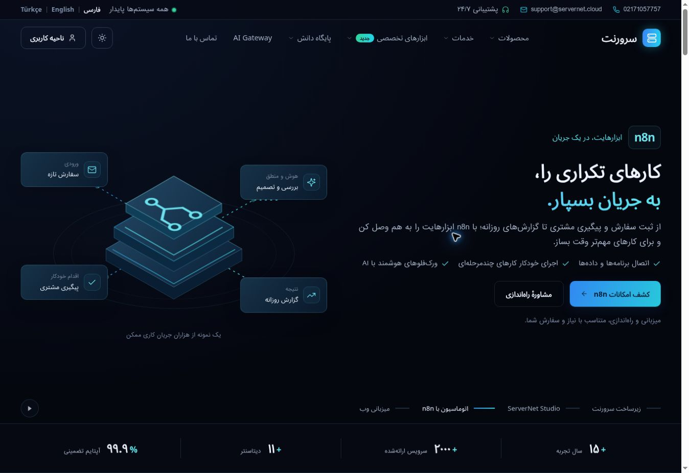
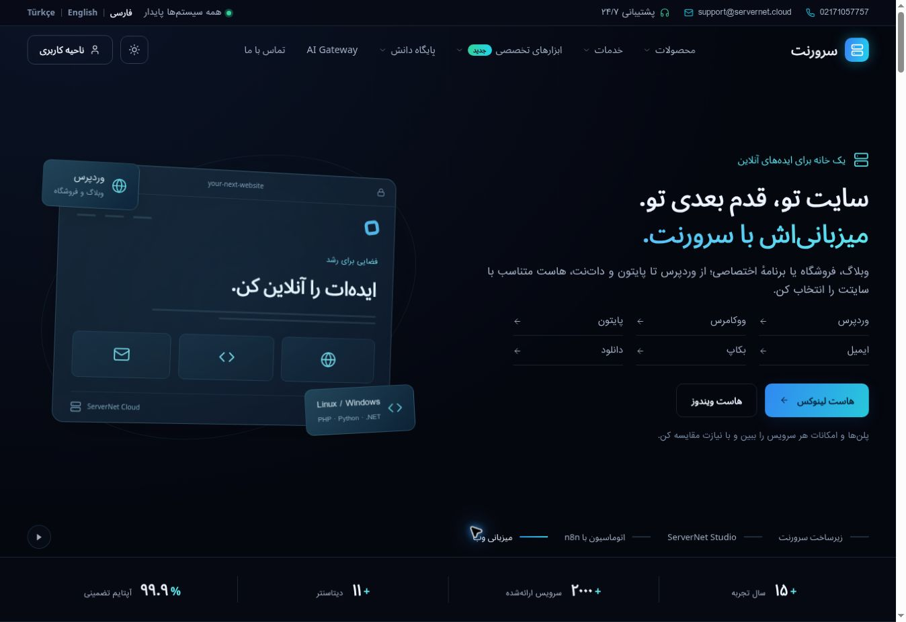

# Four services in one desktop viewport

Base: `develop@8849d6a75f1b3d1e32c409dd01093c358115d6b7`.

The homepage introduction now cycles infrastructure → Studio → n8n → hosting → infrastructure every 5000ms. The selectors below the slides select any service directly. Selection and content interaction pause rotation, and the play control resumes it. Hidden-tab, off-screen, focus and reduced-motion behavior remain. With Studio unconfigured, its slide and selector are omitted and the other three services still cycle.

At desktop widths of at least 1024 CSS pixels and heights of at least 600 CSS pixels, the introduction reserves the viewport minus the existing `--header-h`. It divides this space between slides, selectors and the four original statistics. The globe and Studio scene scale to the available space. Smaller windows and mobile use natural content height to keep content readable. No page scroll is locked.

n8n artwork uses a layered isometric core, connected cards and restrained motion inspired by the supplied Syntra component. It is implemented in the existing Blade/CSS stack with an inline SVG; React, Tailwind and animation dependencies were not added. The content describes possible workflows and links to the existing localized n8n offer and contact page. Hosting promotes existing Linux, Windows, WordPress, WooCommerce, Python, email, backup and download pages. No new prices, provisioning promises or inference calls are introduced.

## Scope and release

Runtime: the homepage, three partials, three `home_slides.php` translation dictionaries, CSS and JS (each in application/public and the separate public webroot). Eleven guarded destinations. A four-anchor home patch preserves unrelated live-only differences.

The fixed-SHA helper under `scripts/home-four-slides-20261123/` stages payloads privately, preflights every destination, holds the shared release lock, backs up replaced files and uses atomic file replacements. Targeted activation compiles only the four affected views in both observed application FPM pools and invalidates homepage cache keys. There is no global cache flush, migration, configuration or billing change. Exact rollback refuses newer live edits, restores all prior files and activates the prior home before removing only this release's new dependencies.

## Validation

Behavioral DOM tests cover the real Blade output in all three locales, the complete four-service loop at five-second boundaries, direct selection of every service, pause/resume, accessibility state, reduced motion, off-screen/hidden tabs, local Studio examples, idempotence and the three-service fallback. Three disposable-file release tests cover preservation, concurrent edits and guarded rollback. Local PHP rendering caught and corrected the n8n route name and an absolute-URL test expectation before publication.

Local PHP 8.4.27 results: 14 related Laravel tests / 385 assertions passed. Fourteen DOM tests and three release tests passed. All ten workflow runs at final source head `2e896416aa7214060931aab3498e900e9c71dc39` passed; automated code review completed without findings. An additional local rendering/pricing run passed 42 tests / 393 assertions (overlaps the related suite; counts are not additive).

Synthetic preview pages compile the real home intro and partials; only the network globe is replaced with a static image and a sample region. The review shell offers 1024×600, 1280×720, 1366×768, 1920×1080 and mobile sizes; its optional `?live` mode embeds the real public homepage. Temporary review files must be removed by their pinned hashes after acceptance.

## Production acceptance — 23 November 2026, 10:05 Tehran

PR [384](https://github.com/servernetir/server/pull/384) merged as `c023566807f0fea2c88ee2e8883eded6dbaf2025`. All eleven destinations installed and verified. Both observed application FPM pools compiled the four views, confirmed Studio configured and reported no general cache flush. Final installed homepage SHA-256: `03543be0bd5faf871c52fca7fde156a848bdd56ae63e9adb1ab625d2c8134fab`.

Canonical `/`, `/en` and `/tr` each returned 200 with four localized slides, four selectors and interval 5000, in the required order. The assets at the versioned URLs emitted by the real page returned 200 and matched:

| Asset | SHA-256 |
| --- | --- |
| `studio-carousel.css` | `f50e7dccb334cd0a585c67fa83b448245ad90c362f0387aac7bee6e404009b8e` |
| `studio-carousel.js` | `e60d726fd7b78d25e63d3ea198c3e0ad51e468c898a4c4db0450bff5e357acf5` |

The dedicated Chrome browser observed infrastructure first, the real globe canvas, and a complete automatic Studio → n8n → hosting → infrastructure cycle. Successive observed transitions were approximately 4980, 5014 and 4998ms apart. Manual selection of n8n and hosting paused the cycle and displayed the matching slide. The connected local browser was unavailable, so acceptance used the dedicated browser instead.

The same-origin review shell embedded the **actual production homepage** for viewport checks:

| Outer viewport | Content width after scrollbar | Statistics bottom | Selectors top | Lowest copy bottom across all slides |
| --- | ---: | ---: | ---: | ---: |
| 1024×600 | 1009 | 600 | 450 | 438 |
| 1280×720 | 1265 | 720 | 570 | 527 |
| 1366×768 | 1351 | 768 | 614 | 579 |
| 1920×1080 | 1905 | 1080 | 926 | 749 |

All four production checks had zero horizontal overflow and all copy above the selectors. At the native browser viewport, all four slides were present, the statistics bottom was 936 CSS pixels in a 936px viewport and horizontal overflow was zero. Screenshots below show the actual page at its top, with n8n and hosting selected.

The synthetic real-Blade review also checked all three locales at 1024×600, with every copy above the selectors; mobile outer widths 320/390 yielded 305/375 content pixels, all four selectors, no horizontal overflow and no untranslated keys. Light/dark Studio appearance was visually checked. These are desktop and iframe responsive checks, not physical-phone acceptance. The bounded console error read showed browser-extension metadata errors and no carousel script error.

All three temporary review folders (`fc2430c100db`, `9e79e9b2277c`, `2e896416aa72`) were removed after verifying their five pinned files. No temporary activation folder remained. The public homepage was left open for review. No purchase, message, model inference or provider provisioning was triggered.

## Rollback

Private stage and backups: `/home/servernetcloud/deploy-backups/home-four-slides-20261123-c023566807f0/`. The helper is pinned to SHA-256 `f3ce52379a0b878c750624f99671fb1f7344285943d6e80cc727e5444dccb226`. Its `rollback` mode at merge SHA `c023566807f0fea2c88ee2e8883eded6dbaf2025` checks every after-hash and backup, restores the prior homepage and dependencies, activates the prior views, then retires only this release's four new files. Any newer live edit stops rollback before mutation. It restores the prior two-slide, seven-second introduction. Reverting older carousel releases requires reverting this release first.

Status: installed and confirmed in production; source and acceptance evidence recorded in develop.
