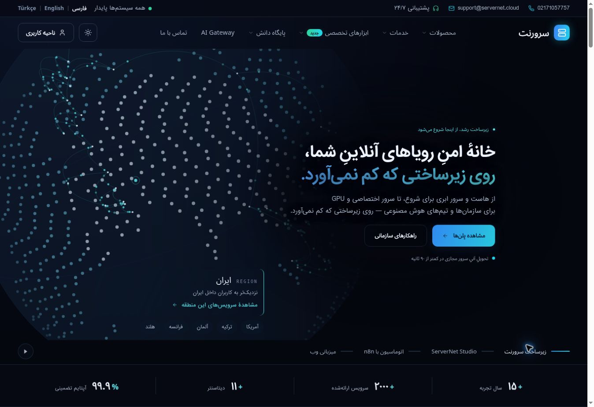

# Full-stage infrastructure globe

Base: `develop@3b0aebfb7940c594cd7f2729aee10bb4412187b2`.

On the first desktop slide, the geographic canvas now spans the full hero stage behind the editorial copy. Its responsive square is 76vw (bounded to 740–1440px), roughly twice the prior visible globe diameter at common laptop widths. The globe is at z-index 0, copy at 2 and region controls at 3. A directional fade and a soft background veil behind the copy keep text legible. RTL places the globe left; LTR mirrors it to the right. Region controls use a small glass surface above the geographic artwork. Dragging and keyboard rotation use the existing canvas and handlers.

The change applies only to `#hero-infrastructure` at desktop widths ≥1024px and heights ≥600px. It uses the existing full-viewport introduction layout, including selectors and statistics. Mobile, the other three slide presentations and the five-second carousel behavior retain their current rules. No HTML, JavaScript, translations, account or financial behavior changes.

Two runtime destinations: application/public and the separate public-webroot copy of `studio-carousel.css`. The guarded release at `scripts/home-globe-layer-20261123/` uses the shared release lock, private backups, before/after hashes, targeted activation and homepage-only cache invalidation. The preview shell embeds the real production homepage and loads the proposed stylesheet after its existing assets; it does not modify production application files. Its two temporary files are removed by exact hashes after acceptance.

## Production acceptance — 23 November 2026, 10:30 Tehran

PR [386](https://github.com/servernetir/server/pull/386) merged as `30da477dd3b623eaf21991b3e52858a7f3206d5a`. Both CSS destinations installed and verified at SHA-256 `1606cdb6ad3e62854d6b40e1391982041b99d5f69d496a0331f70132db55e6d9`. Targeted activation succeeded in both observed application FPM pools, compiling four existing views and invalidating only homepage cache keys; no general cache flush was performed.

Three disposable-file release tests, PHP activation-helper lint and whitespace checks passed locally. All five triggered workflow runs (including the homepage presentation suite) passed at source head `84810f3c7f705824db582135c5d5390d5e0a0d12`; automated code review completed without findings.

The pinned CSS preview over the actual homepage verified Persian RTL and English LTR at these viewports. All cases had no horizontal overflow, the statistics at the viewport bottom, globe z-index 0, copy z-index 2, and successful hit-testing of the main CTA and a region button:

| Outer viewport | Content width | Globe box width | Statistics bottom |
| --- | ---: | ---: | ---: |
| 1024×600 | 1009 | 778 | 600 |
| 1280×720 | 1265 | 973 | 720 |
| 1920×1080 | 1905 | 1440 | 1080 |

Dark Persian and light English were visually accepted; the English composition mirrored the globe to the right. Turkish at outer 1280×720 also had zero overflow, absolute globe positioning and statistics bottom 720. At mobile outer width 390 (375 content pixels), the globe retained its normal relative positioning and horizontal overflow was zero. These are browser/iframe measurements, not physical-device testing.

The actual public homepage without the preview stylesheet then confirmed a 1036px globe box, globe z-index 0 and copy z-index 2 at content width 1348 and viewport height 936. The statistics bottom remained 936 and horizontal overflow was zero. The initial infrastructure slide and manual selection were observed, and the final screenshot shows the actual production page.

Canonical `/`, `/en` and `/tr` returned 200, four slides and interval 5000. The versioned public CSS URL matched the installed SHA-256. The home view remained unchanged at `03543be0bd5faf871c52fca7fde156a848bdd56ae63e9adb1ab625d2c8134fab`. The two temporary preview files were removed only after both hashes matched, and no temporary activation folder remained.

## Exact rollback

Private stage: `/home/servernetcloud/deploy-backups/home-globe-layer-20261123-30da477dd3b6/`. The release helper SHA-256 is `96053bb027719bada493488ec4ba11db3346cf7d42e8dbaa7d1dac4f3e391022`. Run its guarded `rollback` at fixed merge SHA `30da477dd3b623eaf21991b3e52858a7f3206d5a` to restore both prior CSS copies (`f50e7dccb334cd0a585c67fa83b448245ad90c362f0387aac7bee6e404009b8e`) and perform targeted activation. Any newer live edit stops rollback before mutation. Reverse this layer before reverting the earlier four-slide release.

Status: installed and confirmed in production; source and acceptance evidence recorded in develop.
