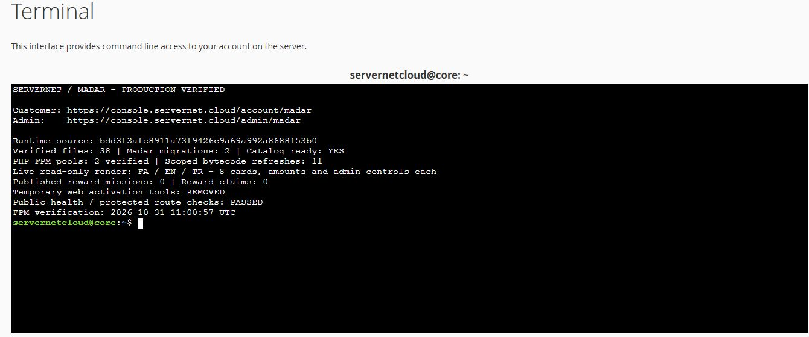

# انتشار زندهٔ مدار سرورنت — ۳۱ اکتبر ۲۰۲۶

**وضعیت: در تولید نصب و تأیید شد.** بخش مشتری در `https://console.servernet.cloud/account/madar` و مدیریت در `https://console.servernet.cloud/admin/madar` ثبت شده‌اند. مسیرهای مشتری fa/en/tr پشت ورود و مسیر مدیریت پشت ورود admin هستند. هشت مأموریت و مبالغ پایه نمایش داده می‌شوند؛ **کمپین مالی جدید و بودجهٔ تشویقی فعال نشده‌اند، بنابراین دریافت مدارکِ پاداش تا انتشار مأموریت دارای بودجه بسته است.**

مجوز: درخواست صریح مالک در همین نشست برای انتشار نسخهٔ تأییدشده روی سایت اصلی. PR [۱۸۰](https://github.com/servernetir/server/pull/180) با کنترل HEAD برابر `638df34024e20d72bfca5514e2e8b28dc3754812` ادغام شد. نسخهٔ اجرایی از merge commit برابر `bdd3f3afe8911a73f9426c9a69a992a8688f53b0` و مبنای delta برابر `0861aab6d5452db065a7e1cbaaa3c9d3cd0bddeb` است. محتوای هر۳۶ فایل سورس اجرایی در merge با نسخهٔ مصوب PR یکسان بود.

## محدوده و حفظ تغییرهای زنده

۳۶ فایل سورس، با دو نسخهٔ اضافی asset در app/public، به **۳۸ مقصد** نگاشت شدند. assets عمومی مستقلاً در `public_html/assets/{css/madar.css,js/madar.js}` نصب شدند. تست، مستند، vendor، index.php، تنظیمات خصوصی، cron، provider و دادهٔ مشتری در بستهٔ کپی نبودند.

پیش‌بررسی فقط‌خواندنی: PHP8.4.27، درایور بومی `mariadb`، نبود schema مدار، نبود config/route cache و آزادی هر دو قفل اشتراکی انتشار تأیید شدند. ابزار ابتدا نام درایور را فقط mysql می‌پذیرفت؛ قبل از نوشتن اپ متوقف شد و پذیرش هر دو نام MySQL/MariaDB با تست اضافه شد.

دو پیش‌نیاز فقط‌خواندنی `HermesSectionOversight.php` و `config/hermes_growth.php` در Git بودند ولی در نصب زنده وجود نداشتند؛ فقط همین دو مسیر با نسخهٔ مصوب به‌عنوان فایل جدید پذیرفته شدند. نبودِ هر فایل مشترک دیگر همچنان توقف ایجاد می‌کند.

اختلاف‌های زنده در `DiscountEngine.php` و `routes/web.php` حفظ شدند. اختلاف موتور تخفیف، اتصال‌های تولدِ نصب‌نشده بود؛ این انتشار آن سیاست مستقل را وارد تولید نکرد. در فایل مسیرها فقط دو require مدار اضافه شدند و auth مشتری، وضعیت فعال و کنترل IP موجود حفظ شدند. تبدیل مسیرها روی سورس مبنا دقیقاً delta مصوب Git را بازتولید کرد؛ هیچ require دیگر یا middleware تازه‌ای تحمیل نشد.

هر دو قفل `.servernet-web-release.lock` و `servernet-release.lock`، manifest، پشتیبان خصوصی، کنترل SHA-256 پیش/پس، mode و تعویض اتمی فایل‌ها اعمال شدند. plan تأییدشده: `1b786db7a2f4508a20fb0611a074237b5cc96a9252f4010bffd1ef1fc9193242`؛ پشتیبان و رسیدها در پوشهٔ خصوصی همان release خارج webroot نگه‌داری شدند. ابزارهای اجرایی در `scripts/madar/` ثبت شده‌اند؛ ابزار نصب نهایی از `f330157bf770aa1440152f30e6a9328abc320ea8` و فعال‌سازی وب از `847d83ae7c9f7b1078c9732d9c4145416b91745a` استفاده شد.

## دیتابیس، فعال‌سازی و پذیرش

فقط دو migration جدید مدار با `--path` دقیق و `--force` اجرا شدند؛ seed، migrate عمومی و rollback داده اجرا نشدند. قبل از اجرا، فهرست migration و وضعیت نبودِ جدول‌های مدار خصوصی پشتیبان‌گیری شد. schema بعد از اجرا آماده، تعداد کنترل مأموریت۸ و تعداد نسخهٔ منتشرشده و مشارکت‌ها صفر بود.

۹ view مرتبط compile/lint شدند و نسخهٔ compiled قبلی خصوصی پشتیبان گرفته شد. دسترسی HTTPS مرورگر متصل به سایت به `ERR_CONNECTION_CLOSED` رسید؛ نشست cPanel فعال ماند و انتشار از همان حساب ادامه یافت. این خطا به‌عنوان خرابی سایت یا دورزدن ورود تعبیر نشد.

برای فعال‌سازی PHP وب، کلاینت FastCGI موجود مخزن با checksum ثابت استفاده شد. تنها دو Unix socket مشاهده‌شده و متعلق به UID همان حساب پذیرفته شدند. primary موقت با directory0700، فایل0600، منع HTTP و گارد داخلی FPM/مسیر/حساب اجرا شد؛ GET وPOST ناشناس روی هر دو دامنه پیشاپیش۴۰۴ بودند. ۴۳ مسیر PHP/compiled از همان manifest و hashهای پس از نصب کنترل شدند. روی دو pool، مجموعاً۱۱ bytecode موجود invalidate و بارگیری کلاس‌های جدید تأیید شد. PHP8.4.27، `validate_timestamps=1` و `revalidate_freq=2` مشاهده شدند. آخرین verify برابر `2026-10-31T11:00:57+00:00`، معادل۱۴:۳۰:۵۷ تهران بود. این فعال‌سازی bootstrap اپ، query، تغییر داده، اجرای worker یا تماس بیرونی نداشت.

پذیرش محتوای زنده: کنترلر و view مشتری و مدیریت در fa/en/tr، با هویت ساختگیِ ذخیره‌نشده و تراکنش READ ONLY رندر شدند. برای هر زبان۸ کارت،۸ مبلغ و۸ کنترل مدیریتی، بدون کلید خام ترجمه، دیده شدند. تراکنش rollback شد؛ ورود/خرید/تأیید مدرک/مصرف پاداش واقعی آزمایش نشد. این شاهد رندر با ورود واقعی مشتری در مرورگر متفاوت است.

کنترل بیرونی نهایی: خانهٔ fa/en/tr و GPU پاسخ۲۰۰، مسیرهای مدار مشتری در سه زبان پاسخ۳۰۲ ورود، و مدیریت پاسخ۳۰۲ ورود admin دادند. CSS/JS روی دامنهٔ اصلی و console پاسخ۲۰۰ و hash برابر سورس داشتند. هر دو ابزار موقت وب پس از کنترل hash حذف شدند؛ مسیر آن‌ها۴۰۴ است. cache مشترک flush نشد.

## آزمون‌ها و مرز نتیجه

- نسخهٔ مصوب PR:۱۰۵ تست مالی/ویژگی و۷۰۵ assertion، یک تست MariaDB با۱۷بررسی و۴۸حالت مرورگر موفق؛ [CI همان HEAD](https://github.com/servernetir/server/actions/runs/41191237649).
- پس از تطبیق با develop تازه:۱۰۸تست/۷۶۷بررسی محلی موفق، شامل سه تست ثبت و سلامت روت.
- ابزار نصب:۹تست ایزولهٔ حفظ اختلاف، هم‌زمانی، مقصد عمومی، فقدان پیش‌نیاز، MariaDB و rollback موفق؛ پروتکل FastCGI:۶تست موفق. PHP و Python ابزارها lint/parse شدند.
- پذیرش تولید:۳۸ هش فایل، دو migration، دو pool وب، شش رندر فقط‌خواندنی، چهار بررسی asset و ده بررسی نهایی HTTP موفق.

محدودیت: دیدن پنل زنده در مرورگر متصل به دلیل بسته‌شدن اتصال HTTPS ممکن نشد؛ چک بصری موبایل/تم مربوط به۴۸حالت CI نسخهٔ مصوب است. هیچ ادعای افزایش ترافیک/فروش، انتساب خودکار خرید، اعتبار مصرف ساعتی GPU یا فعال‌بودن بودجهٔ پاداش از این انتشار نتیجه نمی‌شود.

## بازگشت

ابتدا پذیرش مأموریت‌ها بسته بماند. بازگشت فایل فقط از before همان release و با guard هش نصب‌شده و دو قفل مشترک انجام شود؛ ویرایش جدیدتر باعث توقف می‌شود. اتصال‌های مستقلِ زنده بازنویسی نشوند. schema افزایشی و داده‌ها حفظ شوند؛ `down()`، حذف جدول یا restore کلی دیتابیس روی تولید اجرا نشود. پس از بازگردانی، viewهای مرتبط دوباره compile و فقط همان مسیرهای PHP وب فعال شوند.

رسید ساختاری: [پذیرش تولید](madar-production-acceptance-20261031.json). تصویر زیر رسید کنترل انتشار در ترمینال همان حساب است؛ تصویر پنل مشتری نیست.

