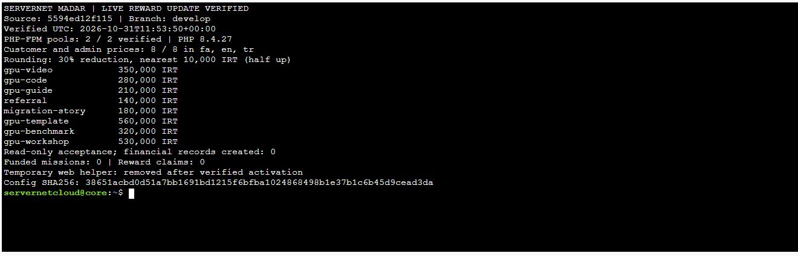

# کاهش مبلغ مأموریت‌های مدار — ۳۱ اکتبر ۲۰۲۶

**در تولید نصب و تأیید شد.** بنا به درخواست صریح مالک، مبلغ پایهٔ هر هشت مأموریت۳۰٪ کاهش یافت و به نزدیک‌ترین۱۰هزار تومان، با گردکردن نیمه به بالا، تبدیل شد. سورس اجرایی [5594ed12](https://github.com/servernetir/server/commit/5594ed12f115b09df587a243bd5943dcbd644619) در `develop` ثبت شد. مسیر مشتری: [مدار سرورنت](https://console.servernet.cloud/account/madar).

| مأموریت | مبلغ قبلی، تومان | مبلغ جدید، تومان |
|---|---:|---:|
| از پرامپت تا پرده | ۵۰۰٬۰۰۰ | ۳۵۰٬۰۰۰ |
| کد روی مدار | ۴۰۰٬۰۰۰ | ۲۸۰٬۰۰۰ |
| مسیرت را یاد بده | ۳۰۰٬۰۰۰ | ۲۱۰٬۰۰۰ |
| هم‌مدار شویم | ۲۰۰٬۰۰۰ | ۱۴۰٬۰۰۰ |
| روایت یک تغییر | ۲۵۰٬۰۰۰ | ۱۸۰٬۰۰۰ |
| یک‌بار بساز، همه اجرا کنند | ۸۰۰٬۰۰۰ | ۵۶۰٬۰۰۰ |
| عدد واقعی، انتخاب آگاهانه | ۴۵۰٬۰۰۰ | ۳۲۰٬۰۰۰ |
| از تماشا تا اولین خروجی | ۷۵۰٬۰۰۰ | ۵۳۰٬۰۰۰ |

## دامنه و پذیرش

مبنای Git برابر `b4b5b555094c2a5af5717ce6a277eae2efe823c7` بود. فقط `website/config/madar.php` به مقصد متناظر اپ فعال نصب شد. تست‌های وابسته به مبلغ، سند کاتالوگ، پیش‌نمایش و سه ابزار محدود انتشار در Git به‌روز شدند؛ فایل‌های اجرایی دیگر، CSS/JS و شروط مأموریت تغییر نکردند.

manifest، پشتیبان خصوصی، هر دو قفل انتشار، کنترل mode و هش پیش/پس و جایگزینی اتمی اجرا شدند. plan برابر `c07eaa22f2e8cb7167ccdb393736e37d01696da2bbbd21643b62bfff9132d238` است. SHA-256 قبلی فایل `389cc5ebf09f5a2c3a5b0246580a0dd55efadbbe1b145e8d834c6ad1b47e2779` و هش نصب‌شده `38651acbd0d51a7bb1691bd1215f6bfba1024868498b1e37b1c6b45d9cead3da` است.

هر دو pool متعلق به همان حساب با PHP8.4.27 مبلغ‌های جدید را بازخواندند؛ فقط همین فایل در هر pool از OPcache باطل شد. آخرین verify وب `2026-10-31T11:52:53+00:00` بود. ابزار موقت HTTP-denied پس از کنترل hash حذف شد. دسترسی GET/POST پیش از اجرا در هر دو دامنه۴۰۴ داد؛ پس از حذف، دامنهٔ اصلی۴۰۴ و console با redirect۳۰۱ به اصلی، در نهایت۴۰۴ داد. cache مشترک پاک نشد؛ migration و تغییر مالی انجام نشد.

پذیرش `2026-10-31T11:53:50+00:00`، معادل۱۵:۲۳:۵۰ تهران: کاتالوگ و view مشتری/مدیریت در fa/en/tr با هویت ساختگیِ ذخیره‌نشده و تراکنش READ ONLY رندر شدند؛ در هر زبان۸ کارت و۸ مبلغ مشتری و۸ مقدار مدیریتی با مبلغ‌های جدید مطابقت داشتند. تراکنش rollback شد. تعداد مأموریت‌های منتشرشده و درخواست‌های پاداش پیش/پس صفر بود و config cache وجود نداشت. **بودجهٔ جدید فعال نشده؛ دریافت مدارک پاداش همچنان تا انتشار مأموریت دارای بودجه بسته است.**

آزمون‌های همین تغییر:۳۳تست MadarHub/MadarFixedMission و۲۶۹assertion موفق؛ PHP lint، Python parse، Pint و `git diff --check` موفق. پیش‌نمایش از رندر جدید بازتولید شد. چک موبایل/تم دوباره اجرا نشد چون CSS/JS تغییر نکرده است. خانه و GPU پاسخ۲۰۰ و چهار مسیر خصوصی مشتری/مدیریت پاسخ۳۰۲ ورود دادند. رندر تشخیصی فوق ورود واقعی مشتری در مرورگر نیست.

## بازگشت

فقط همین config از before همان release، با guard هش نصب‌شده و دو قفل مشترک، قابل بازگشت است؛ تغییر جدیدتر موجب توقف می‌شود. پس از بازگشت، بازخوانی config در هر دو pool تأیید شود. داده‌ها و نسخه‌های منتشرشدهٔ مأموریت‌ها بازنویسی نشوند. هیچ snapshot منتشرشده‌ای هنگام این تغییر وجود نداشت.

رسید ساختاری: [پذیرش کاهش پاداش](madar-rewards-acceptance-20261031.json). تصویر زیر رسید ترمینال همان حساب است؛ تصویر پنل مشتری نیست.

