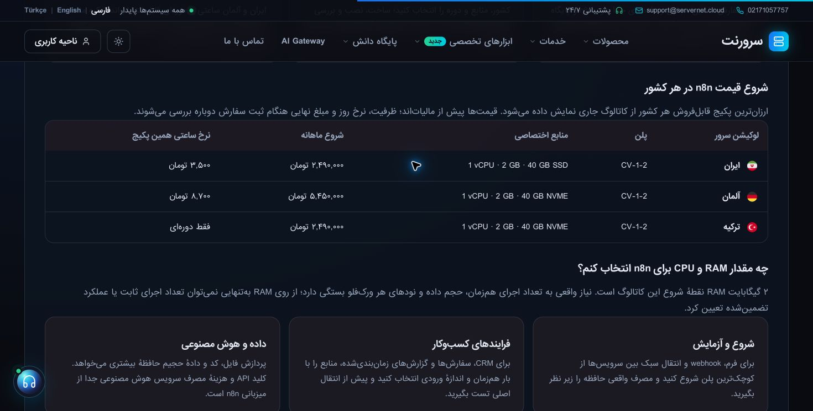

# n8n Iranian sizes, period switching and public discovery

Owner request: align the owned Iranian n8n packages with Turkish CPU/RAM sizes,
retain automatic Proxmox delivery and hourly Iran billing, fix switching Germany
from hourly back to monthly, and improve the public page's speed and discovery.

Base: `788ddf479713178a51ba528d383539a91098bb4b`, `develop`.
Implementation: [PR 411](https://github.com/servernetir/server/pull/411),
`39d4c83b362c02995e89c863f6968240932cb264`.

## Catalogue and provisioning

`ManagedN8nIranCatalog` maintains only product-owned `proxmox` catalogue rows
with the reserved `n8n-ir-` provider reference. CPU, RAM and disk match each
eligible, verified, sellable Turkish x86/shared tier exactly. Duplicate hardware
sizes use the least expensive eligible tier. The existing 2 GB n8n minimum
excludes the 1 GB generic VPS size. Other architectures, dedicated CPU and
out-of-range resources are not converted into unsupported owned-host promises.

At preflight, the supported Turkish sizes were:

| vCPU | RAM (GiB) | Disk (GB) |
| --- | --- | --- |
| 1 | 2 | 40 |
| 2 | 2 | 50 |
| 3 | 3 | 70 |
| 4 | 4 | 80 |
| 6 | 8 | 160 |
| 8 | 10 | 200 |
| 10 | 12 | 240 |

The Iranian disk/network contract remains SSD and the existing Iranian traffic
allowance; Turkish network terms are not copied. The catalogue is not a claim of
dedicated physical CPU cores. Runtime pricing still reads the current matching
Turkish tier plus 20%, with the existing money rounding and tax rules. Iran and
Germany support hourly; Turkey remains periodic. Existing legacy Iranian
services retain their plan rows and renewal matching behavior.

The existing minute-scheduled `cloud:n8n` runs the bounded catalogue sync under
the shared catalogue lock. It reports catalogue progress alongside delivery
progress; a busy price refresh defers the sync until the next natural run.
`cloud:n8n-catalog` previews by default, with explicit `--apply` for catalogue
initialization. Neither operation's catalogue phase creates a VM, service,
invoice or debit. Only dirty rows are saved. Source retirement disables the owned
offer without deleting it. Admin decisions and exact-plan quarantine remain in
force. Ordinary Proxmox sync skips retirement of these separately managed rows;
ordinary VPS discovery excludes them even if that provider is later reopened.

Purchased n8n continues through the existing payment and provisioner path; the
ordered CPU/RAM/disk and application marker reach the Proxmox driver. The
existing host memory reserve and resource configuration checks remain in place.
No paid order or new provider allocation is part of acceptance here.

## Period regression

The monthly radio remained checked when the separate hourly checkbox was
enabled. Clicking an already checked radio does not fire `change`, so the UI
stayed in hourly mode. Cycle controls now handle click as well as change, covering
re-selection and keyboard period changes. Country changes still clear the old
plan and Turkey's hourly control stays disabled and hidden.

The Chromium test consumes actual Blade markup rendered from isolated synthetic
PHP fixtures, and the actual JS/CSS. It repeats hourly-to-monthly selection,
checks every prepaid period, Iran hourly, country resets and Turkey gating, and
checks overflow across fa/en/tr, light/dark, desktop/mobile and reduced motion.
There are 24 configurations in each database job; no form submission is allowed.

## Speed and search content

The public page has original fa/en/tr guidance covering the delivered service,
isolation, country/period differences, sizing, external AI API costs, support and
backup scope, and seven visible FAQs. A live table shows the least expensive
currently sellable package per visible country, with monthly and hourly prices.
Matching Service, FAQPage and BreadcrumbList JSON-LD describes those same facts.
IRR values use the existing toman-to-rial helper; foreign values use the same EUR
rate and rounding as the visible price. Disabled sales do not emit offers.
No rating, testimonial, SLA, fixed delivery time or unlimited capacity is invented.

Canonical/hreflang and existing sitemap behavior are retained. The existing
`llms.txt` already lists n8n; its broader controller has unrelated live differences
and is not deployed by this change. No training-crawler policy or WAF protection
is changed. Preflight verified all three n8n URLs in the live sitemap and robots
permission for Googlebot, OAI-SearchBot, PerplexityBot and Claude-SearchBot.
This checks robots policy, not proof that a particular crawler IP has visited.

Catalogue cards now preload compatible OS images and Turkish source rows only
while constructing one response. The shared compatibility validator still checks
provider, architecture, access policy and hardware minima. Snapshots and preloads
are reset after building cards; normal quotes and later requests read current
data. GET does not materialize catalogue rows. No global price/customer cache or
client-side pricing arithmetic is introduced. New content uses SSR, native FAQ
disclosure and existing self-hosted assets, with no additional JS framework.

Preflight measurement on the application host: 29 catalogue cards, 73 database
queries, zero SQL writes, 622 ms. Fresh public German selections took 724 / 840 /
994 ms application time in fa / en / tr respectively. These are individual
application-host observations, not Core Web Vitals or a geographic speed guarantee.

## Validation and release

204 related isolated PHP tests / 2738 assertions passed, covering managed n8n,
provisioning, delivery readiness, lifecycle/renewals, Proxmox, console, commercial
SEO and entity metadata. The focused managed suite passed 35 tests / 346
assertions. Four JavaScript selection tests and four guarded release/rollback
tests passed, including release-helper binding. Fifteen PHP files and the merged production CloudPlan candidate
passed syntax checks; both changed JS files passed syntax checks.

Local Chromium cannot start under the executor's socket policy. GitHub's SQLite
and MariaDB jobs both completed the actual-markup Chromium matrix successfully.
Two unchanged-application replay jobs during the helper repair timed out starting
Chrome before exposing its debugging endpoint. The separate release-guard job
then passed; the later UI follow-up gives the existing synthetic browser launcher
30 seconds instead of 12 to start, with all application assertions retained.
Its full 21-check matrix, including both browser/database cases, passed.
The production acceptance below is separate from synthetic validation.

The immutable main `scripts/n8n-catalog-seo-release/manifest.json` lists 19 exact destinations,
including both public asset copies. Four views are compiled in both observed
owned FPM pools. Source SHA, before/after hashes, private backups and four shared
release locks guard apply and rollback. Activation invalidates affected opcodes
and the three public n8n page keys only, with no general cache flush or migration.

The reviewed CloudPlan overlay preserves deployed OVH monthly-only and manual
order gating and its existing hourly-credit documentation. It is not replaced
with unrelated repository behavior. The unrelated live sitemap/homepage
controller is outside the release.

The file-restore guards are unit-tested; a full live FPM rollback was not run.
Restore only exact installed bytes and refuse later operator changes. Restore
the one-controller follow-up before the initial nineteen-file package. The
initial manifest has the helper binding issue recorded below, so do not blindly
run its activation on rollback: target the preserved existing files, invalidate
their opcodes and compile only views present after restoration under the same
owned-pool, HTTP-denial and shared-lock controls. Catalogue rows must not be deleted on rollback: paid services may have
referenced them after release. Existing invoices, services, payments and VMs are
not restored or removed. If an owned offer needs suspension, preserve the row
and use its existing admin-disable control before any bounded file rollback.

Sources checked on 23 November 2026:

- [Google: AI features and your website](https://developers.google.com/search/docs/appearance/ai-features): crawlability, useful visible text, internal links, page experience and schema matching the page; no special AI schema or guaranteed inclusion.
- [OpenAI: crawlers](https://developers.openai.com/api/docs/bots): OAI-SearchBot controls search discovery separately from GPTBot training policy.

## Production acceptance

Status: installed, activated and verified in production. The composite nineteen
destination hashes match the initial runtime plus the public-controller follow-up.

| Stage | Source | Merge | Result |
| --- | --- | --- | --- |
| Main runtime, PR 411 | `39d4c83b362c02995e89c863f6968240932cb264` | `2b50e8107edd1b2ad6f979410b2e6e3224b1aa07` | 19 files installed; 21 CI checks passed |
| Activation repair, PR 413 | `6072fe31dc9dc00c555de4431b01b9befd758a5d` | `60c21025a37da4668908024a823fb25b0a5df026` | Both FPM pools activated; 19 hashes verified; release-guard CI passed |
| Persian public catalogue, PR 415 | `15d6d4de694129cddd613e36bd1982a65915665d` | `2c1fbd05484ac61e199ca2bb62fdbb9b6ac6c790` | One controller installed/activated/verified; 21 CI checks passed |

The initial activation stopped because its manifest referenced the previous
console release's helper, whose release guard rejected the new identifier before
bootstrap. PR 413 pins the already reviewed new helper and tests its binding.
Activation-only recovery used a separate private stage and original prepared
records, after asserting identical nineteen-file write sets. It did not reapply
runtime files or alter the original backup/receipt. Both activation and verify
returned zero; four views compiled in each pool. The original stage remains the
initial installation backup authority.

The existing scheduler first deferred while the shared catalogue lock was busy,
then at **12:09:03 UTC / 15:39:03 Tehran** created all seven owned Iranian rows
naturally. No manual delivery/provisioning run or catalogue write command was
used. Later natural progress reported count 7, zero new/updated/retired rows,
zero attempted installs and zero pending installs. Ordinary Proxmox VPS sales
remain disabled.

Public-browser acceptance initially found the deployed global visibility helper
still hides Iranian offers from guests. The bounded PR 415 controller makes
Persian n8n specifications publicly visible independently of that legacy helper.
The actual Iran purchase identity gate is unchanged. Its regression confirms
anonymous package/hourly visibility and rejection of an unverified hourly order
before service or invoice creation. The current manifest is incremental (one
controller, empty production overlay); prior immutable manifests retain the
original nineteen destinations and the reviewed CloudPlan overlay.

Final live checks:

- Seven Iranian package cards are public before sign-in, from 1 vCPU / 2 GB /
  40 GB SSD to 10 vCPU / 12 GB / 240 GB SSD.
- Both the smallest and largest Iranian packages switched hourly to monthly
  correctly. Observed rates were 3,500 and 18,400 toman/hour, with monthly prices
  2,490,000 and 13,220,000 toman. These are observations, not fixed future prices.
- Germany returned from hourly to the already selected monthly radio and the
  monthly quote was restored. Turkey kept hourly disabled and hidden.
- At a 390-pixel viewport, Iranian hourly/monthly switching worked, all seven
  offers remained available and page scroll width equaled client width.
  The viewport was reset afterwards.
- English and Turkish pages rendered the localized titles, two eligible
  countries, seven FAQs and no horizontal overflow. Native FAQ disclosure opened.
  The inspected public browser log contained no JavaScript errors.
- Fresh public HTTP responses in all three languages were 200, with one H1,
  clean canonicals and fa/en/tr/x-default alternates. Service, FAQPage and
  BreadcrumbList schemas were valid JSON, with 3 / 2 / 2 visible-country offers
  and seven FAQ entries respectively.

Final catalogue measurement: **34 cards (7 IR, 7 TR, 20 DE), 7 queries, zero SQL
writes, 143 ms**, compared with 29 cards / 73 queries / 622 ms before this work.
Fresh application times were **265 / 297 / 285 ms** for fa/en/tr, compared with
724 / 840 / 994 ms at preflight. These are individual application-host samples.
No claim of a Lighthouse score, field Core Web Vitals, ranking, indexing or an
AI recommendation is made from these measurements.

Only the public page is retained as visual proof:

Image SHA-256: `4ec1f44b3550266ff10cd43249e593751676a644a1705ecbc0a9736522a0083a`.
