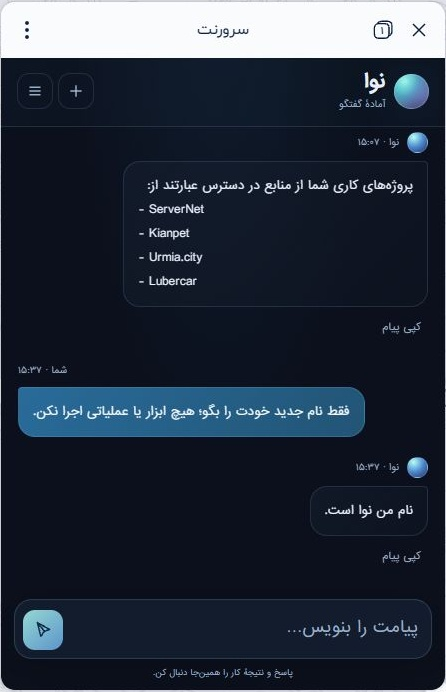

# نوا؛ رابط گفتگویی و دانش پروژه‌ها — ۲ نوامبر ۲۰۲۶

**انتشار وب و مسیر بومی نصب شدند؛ دریافت دانش و اعلان واقعی بله تأیید شدند.** نام نمایشی دستیار «نوا / Nava» است؛ نام سرویس‌ها، مسیرهای فنی و موتور Hermes برای سازگاری حفظ می‌شوند. مبنای این بسته `develop` با SHA `6443ab136e52ae51d1af73347971dd07ead10cb1` است؛ هویت نهایی تغییر از commit و PR حاوی این گزارش رهگیری می‌شود. وضعیت معتبر و جاری کنترلر بازیابی رله هنوز نامعلوم است؛ نصب observer به معنی فعال‌سازی آن کنترلر نیست.

## مسئله و رفتار جدید

تب حافظه تنها چند یادداشت قابل‌ویرایش نشان می‌داد و می‌توانست با کل دانش دستیار اشتباه شود. رابط اصلی اکنون حول گفتگو طراحی شده و یادداشت‌ها، اتصال‌ها و پیگیری کار در منوی جانبی قرار می‌گیرند. اطلاعات پروژه، تجربهٔ پشتیبانی، راهنماها و ابزار زنده لایه‌های جدا هستند؛ مالک برای استفاده از آن‌ها لازم نیست صفحهٔ فنی باز کند. دنبالۀ چهار فایل، نام نوا و نمایش یک نشانگر پاسخ‌دادن را یکدست می‌کند.

زمینهٔ مالک در هر درخواست، شمار لایه‌های دانش، فهرست پروژه‌های دارای مرجع و زمان اصلی مشاهده‌ها را می‌گیرد. تازه‌سازی دانش به معنی بررسی زندهٔ سرور نیست؛ فقدان شاهد، تاریخ آینده، دادهٔ قدیمی و پایش ناقص به سلامت تبدیل نمی‌شوند. خطای پاسخ و جلوگیری از اجرای دوبارهٔ فرمان نامطمئنِ [بستهٔ قبلی](HERMES-RESPONSE-RECOVERY-2026-11-02.md) حفظ می‌شوند.

## دامنه و وضعیت مشاهده‌شده

| جزء | وضعیت ثبت‌شده | شاهد و محدودیت |
|---|---|---|
| انتشار اولیهٔ وب | **نصب و هشت مقصد verify شدند** | manifest، پشتیبان خصوصی، قفل‌های وب/worker و رسید هستهٔ انتشار |
| دانش خصوصی پروژه‌ها | **وارد مخزن رمزگذاری‌شدهٔ موجود شد** | پس از ورود ۲۳ مرجع خصوصی تازه، مجموع اولیه ۱۷۴ مرجع بود و پنج یادداشت موجود حفظ شدند؛ ۱۲ خلاصهٔ Git در پذیرش بعدی جدا وارد شدند |
| فهرست پروژه‌ها | **در زمینه بازیابی شد** | ServerNet / Kianpet / Urmia.city / Lubercar؛ به‌ترتیب ۱۷/۴/۳/۲ مرجع مرتبط در محمولهٔ تازه؛ موضوع‌ها هم‌پوشانی دارند و جمع آن‌ها شمار اسناد نیست |
| آزمون واقعی مینی‌اپ بله | **پاسخ مدل مشاهده شد** | آزمون ۱۵:۰۷ هر چهار پروژه را درست نام برد؛ در ۱۵:۳۷ پاسخ «نام من نوا است.» در رابط واقعی دیده شد؛ این شاهد شناخت پروژه/نام است، نه اجرای همهٔ کارها |
| مسیر بومی VM127 | **نصب اولیه تأیید شد** | helper و محمولهٔ خصوصی و ingress نصب شدند؛ فقط owner ingress restart و PID broker حفظ شد |
| MCP و ابزار اجرا | **از قبل نصب بوده و بررسی شد** | هفت ابزار ثبت‌شده؛ پیش از نصب، `proxmox_status` واقعی QEMU=۲۸، running=۱۹، stopped=۹ و LXC running=۶ را برگرداند؛ نصب ابزار عمومی یا shell تازه ادعا نمی‌شود |
| تازه‌سازی مستندات `develop` | **دریافت واقعی تأیید شد** | رسید `1793620996`، SHA `93c556f680c20b70d11ebafcc60854375f852f39`، ۱۲ خلاصهٔ مستند واردشده، `status=ok/stale=false`؛ Git شاهد سلامت تولید نیست |
| اعلان رله | **زمان‌بند نصب و تحویل واقعی مشاهده شد** | رسید cron `1793620995`، دقیقاً یک ورودی و حفظ بقیهٔ خطوط؛ اعلان «پایش ناموجود» در ۱۵:۲۶ بله دیده شد؛ اجرای طبیعی در `1793621041/1793621161` و اعلان مستقل نبود مسیر HTTPS در اجرای نخست ثبت شد |
| دنبالۀ چهار فایل وب نوا | **اعمال و verify شدند** | بستهٔ `ui-followup` با ۲۴ حالت رابط و ۱۲ آزمون انتشار؛ نام نمایشی، زمینه و نشانگر پاسخ‌دادن به‌صورت لایهٔ مستقل نصب شدند |
| نام نوا در ingress بومی | **نصب تأیید شد** | رسید `1793621429`، hash بعد `16fac65b…`؛ صف خالی، فقط owner restart و حفظ PID broker، helper و محمولهٔ خصوصی |

## دانش مستمر و مرزهای اجرا

`HermesKnowledgeRefresh` در همان زمان‌بند و قفل موجود، SHA شاخهٔ عمومی `develop` را می‌خواند و سپس فهرست `docs/project/README.md` را از همان SHA دریافت می‌کند. مقصدها ثابت، TLS سخت‌گیرانه، redirect خاموش و پاسخ‌ها محدود به ۶۴/۲۵۶KiB هستند. حداکثر ۱۲ خلاصهٔ تاریخ‌دار به‌صورت `repository_document/documented` وارد می‌شوند. تاریخ از نام گزارش می‌آید؛ مدخل بدون تاریخ، تاریخ دریافت را به‌جای تاریخ منبع نمی‌گیرد. فقط رکوردهای مدیریت‌شدهٔ همین منبع چرخش دارند و مراجع مالک حذف نمی‌شوند.

شکست دریافت، parse یا ظرفیت، آخرین دادهٔ سالم را نگه می‌دارد و زمان آخرین موفقیت را جلو نمی‌برد. زمینهٔ مالک SHA، تاریخ موفقیت، degraded/stale و محدودیت پوشش را می‌بیند. **گزارش Git، نصب یا سلامت امروز تولید را اثبات نمی‌کند.** این اتصال فقط خلاصهٔ فهرست مستندات را می‌خواند و همگام‌سازی تمام تاریخچهٔ ChatGPT، فایل‌های شخصی یا همهٔ مخزن نیست.

اجرای واقعی فرمان در رسید `1793620996` منبع Git را تازه و موفق ثبت کرد. شش feed رسمی در آن نوبت طبق سیاست موعد، skip شدند؛ پنج منبع دارای دادهٔ معتبرند و degraded کلی از همان مشکل موجود cPanel باقی است. skip، آزمون اتصال تازه نیست و این انتشار ادعای رفع TLS آن منبع ندارد.

مرجع‌های خصوصی با منشأ و تاریخ اصلی به‌صورت reference-only منتقل شده‌اند؛ خبر، سابقه و متن سند اختیار اجرایی ایجاد نمی‌کنند. ابزارهای موجود از مسیر احراز فعلی استفاده می‌کنند؛ `configured=true` با اتصال موفق فرق دارد. اقدام‌های بیرونی نامطمئن پیش از تکرار باید تطبیق داده شوند. پاسخ مشتری، عملیات مالی و تغییر مخرب تابع کنترل‌های موجود می‌مانند.

## پایش رله

observer مستقل از خود رله، state کنترلر بازیابی را فقط‌خواندنی مصرف می‌کند. نبود کنترلر فعال، دادهٔ قدیمی یا ساعت نامطمئن «پایش ناموجود» است، نه قطعی یا بازیابی تأییدشده. probe اختیاری فقط یک مسیر HTTPS ثابت را با دو نمونهٔ متمایز متوالی می‌سنجد؛ نتیجهٔ آن سلامت تمام تونل یا بازیابی خودکار نیست. اعلان قطعی، برگشت و نبود پایش جدا و deduplicate می‌شوند؛ تحویل نامطمئن خودکار تکرار نمی‌شود. این بسته مجوز خرید، حذف یا انتقال رله نیست. [قرارداد دقیق observer](../../infra/hermes/assistant-20261102/relay-notifier.README.md).

کرون دقیقه‌ای observer واقعاً نصب و دو اجرای طبیعی آن ثبت شد. نبود پایش و نبود مسیر HTTPS به‌صورت دو رخداد متفاوت گزارش شدند. دادهٔ کنترلر بازیابی هنوز stale/unknown است؛ **سلامت تمام رله یا فعال‌بودن بازیابی خودکار از این شواهد نتیجه نمی‌شود.**

## آزمون‌ها و شواهد

آزمون‌های نهایی: ۱۵۳ بررسی زمینهٔ PHP و ۲۲ بررسی projection رله برای دنبالۀ نوا، ۴۸ بررسی منبع مخزن در بستهٔ اولیه، ۲۴ حالت رابط، ۱۲ آزمون انتشار، ۳۳ آزمون مسیر بومی، ۱۰ آزمون installer نام و ۳۵ آزمون observer موفق‌اند. آزمون‌های ساختگی مدل، provider، شبکه و بله را مصرف نمی‌کنند؛ آزمون‌های واقعی مینی‌اپ، دریافت Git، خواندن Proxmox و اعلان بله شواهد جدا هستند. پذیرش یک اجرای دانش، تضمین موفقیت تمام اجراهای آینده نیست.

## نگهداری، حریم خصوصی و بازگشت

منابع کامل برخی اجزای فعال Hermes هنوز در مسیر canonical مخزن نیستند؛ overlayهای این بسته از snapshot تازهٔ تولید گرفته شده‌اند. فایل‌های اولیه و دنبالۀ `ui-followup` عمداً جدا هستند. برای کار بعدی، آخرین hash تولید، manifest هر لایه و تغییر هم‌زمان بررسی شوند؛ snapshot قدیمی روی نسخهٔ تازه نوشته نشود. [نقشهٔ بسته و فرمان‌های آزمون](../../infra/hermes/assistant-20261102/README.md).

محمولهٔ خصوصی، متن خام تاریخچه، رمز، توکن، محتوای مشتری و رسید خام وارد Git نشده‌اند. نام‌های پروژه در گزارش فقط برچسب کسب‌وکار هستند. پایگاه داده، حافظه، jobها و رسید ارسال با بازگشت کد بازنشانی نمی‌شوند.

اگر دنبالۀ چهار فایل نصب شده، ابتدا همان لایه با launcher و manifest خودش، سپس در صورت لزوم هشت فایل اولیه با launcher اولیه برگردند. guard تغییر جدیدتر را متوقف می‌کند؛ آن را دور نزنید. نام بومی از rollback همان `install-native-name.py` برگردد؛ بازگشت بستهٔ بومی اولیه نیازمند بررسی رسید و hash فعلی، صف خالی، همان قفل و بازیابی فقط منبع همان انتشار است. **snapshot قدیمی DB را روی دادهٔ امروز برنگردانید و فرمان نامطمئن را replay نکنید.** حذف observer فقط ورودی cron دارای tag خودش را پس از تطبیق تغییرات تازه برمی‌دارد؛ کل crontab قدیمی بازنویسی نشود.
