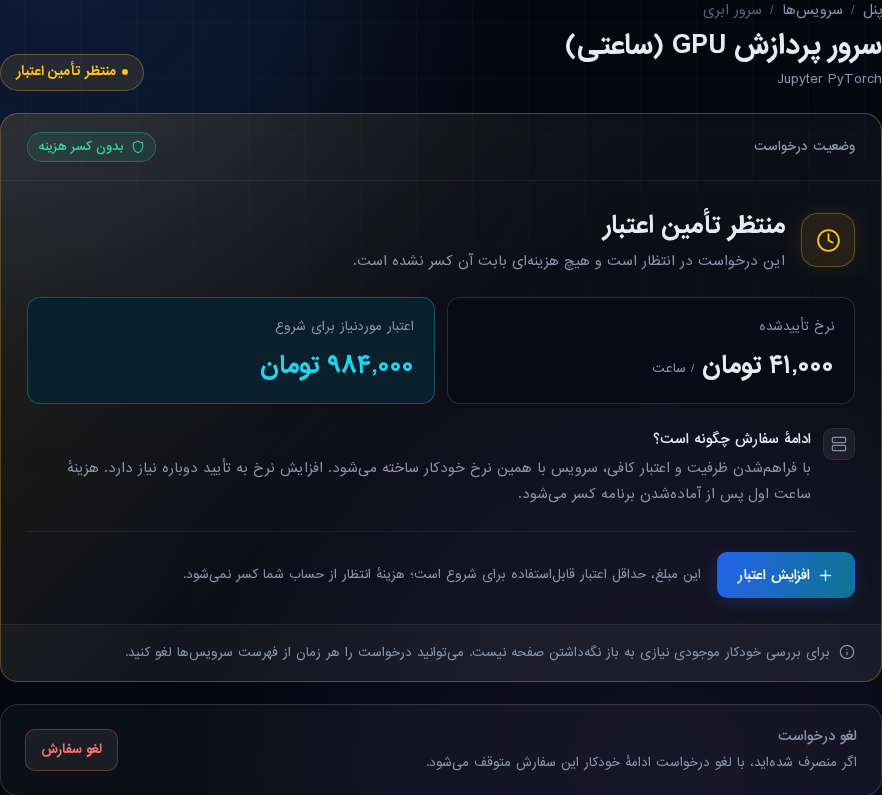

# ظاهر درخواست در انتظار تأمین اعتبار — ۲۶ اکتبر ۲۰۲۶

مبنا: `2c251bef` از develop. دامنه فقط نمایش درخواست بدون پرداخت GPU در صفحهٔ سرور مشتری است. کارت فشردهٔ قبلی به سربرگ وضعیت، نشان بدون کسر هزینه، خلاصهٔ نرخ تأییدشده/حداقل اعتبار قابل‌استفاده، توضیح مرحلهٔ بعد و اقدام برجستهٔ افزایش اعتبار تبدیل شد. لغو درخواستِ منتظر ظرفیت/اعتبار یک ردیف مستقل و جمع‌وجور دارد. حالت فاکتور pending وارد ردیف لغو تازه نمی‌شود، چون قرارداد فعلی برای آن دکمهٔ لغو ندارد.

## فایل‌ها و قرارداد

- `website/resources/views/account/cloud-server.blade.php`: بارگذاری stylesheet نسخه‌دار، نشان وضعیت خواناتر، حذف جداکنندهٔ مکان خالی، partial کارت انتظار و ردیف لغو.
- `website/resources/views/account/partials/gpu-capacity-wait.blade.php`: ساختار معنایی عنوان و dl، منبع مبلغ‌های قبلی و همان شروط/فرم‌ها.
- `website/public/assets/css/cloud-request.css`: فقط کلاس‌های همین بخش؛ تم روشن/تیره، RTL/LTR، اندازهٔ ذاتی، اقدام حداقل ۴۴px و فوکوس آشکار.
- `website/lang/{fa,en,tr}/ui.php`: هشت کلید همسان جدید؛ متن‌های سیاست مالی قبلی حفظ‌اند.
- `website/tests/Feature/GpuRequestPresentationTest.php`: رگرسیون رندر و قرارداد اقدام‌ها.
- `scripts/deploy-pending-request-ui.py`: آماده‌سازی پیش‌فرض بدون نوشتن روی فایل فعال؛ اجرای صریح جداگانه، SHA ثابت، دو قفل انتشار موجود، patch محدود با حفظ line ending و اختلاف‌های نامرتبط، پشتیبان خصوصی، lint، hash guard و کامپایل فقط دو Blade مرتبط.

نرخ و حداقل اعتبار مستقیماً از همان service/metadata قبلی نمایش داده می‌شوند. مبلغ دوم «کسری کیف پول» یا پرداخت فوری نیست. ورود تأیید تعرفه، quoted_price_irt، CSRF، مسیرهای محلی‌شده و شروط پرداخت/لغو تغییر نکرده‌اند. backend، داده، migration، cron، سفارش‌دهی provider و سیاست صورتحساب تغییر ندارند.

## آزمون واقعاً اجراشده

PHP 8.4.27 و وابستگی‌های منطبق با composer.lock در checkout ایزوله؛ APIها fake هستند.

- `GpuRequestPresentationTest` و `CloudServerPageLayoutTest`: **۱۶ تست، ۲۰۳ assertion، همه موفق**. سه زبان، اعتبار/نرخ، POST/CSRF تعرفه و لغو، فاکتور منتظر پرداخت، حالت بسته/تحویل‌شده و نبود تماس/نوشتن مالی هنگام رندر.
- Chromium: **۲۷ حالت موفق**؛ fa/en/tr × روشن/تیره × عرض‌های ۳۲۰،۳۹۰،۷۶۸،۱۴۴۰ و سه حالت دیگر انتظار روی موبایل. عرض صفحه و اجزای کارت، عدم برخورد اقدام با لغو، هدف لمسی، فوکوس، ورودی تعرفه و خطای JavaScript بررسی شدند. تصاویر فارسی دسکتاپ/موبایل و انگلیسی روشن بازبینی شدند. این تست‌ها HTML رندرشدهٔ ساختگی هستند، نه ورود به حساب مشتری در تولید.
- بررسی helper: انطباق خروجی با سورس جدید روی baseline، حفظ CRLF/LF مختلط و اختلاف نامرتبط تولید، دو مقصد مستقل CSS و هفت فایل مقصد.
- suite گسترده‌تر `GpuCapacityOrdersTest|CloudServerPageLayoutTest`: از۳۱تست،۲۱موفق،۴شکست و۶خطا. همین تعداد و همان نام‌های شکست/خطا روی baseline دست‌نخورده تکرار شد؛ suite کامل سبز نیست. تغییرات در محدودهٔ UI نگه داشته شدند.
- `git diff --check` و lint پایتون موفق‌اند. lint فایل‌های staged PHP/Blade روی میزبان بخشی از preflight انتشار است.

## وضعیت انتشار و بازگشت

**نصب و پذیرش محدود تولید انجام شد.** سورس در develop: `5b262470123e7edf5e2250eae892fee79a5b85c6`. انتشار: `pending-request-ui-20261026-5b262470`، از ترمینال حساب cPanel با همان helper بازبینی‌شده و hash تأییدشده اجرا شد.

- آماده‌سازی: هفت فایل، صفر نوشتن روی فایل فعال، lint PHP و Blade موفق.
- نصب: هفت فایل، همهٔ hashها تطبیق یافت و فقط دو template مربوط کامپایل شدند؛ قفل‌های دوگانهٔ موجود در آماده‌سازی و اجرا گرفته شدند.
- CSS عمومی در هر دو دامنه `servernet.cloud` و `console.servernet.cloud` پاسخ۲۰۰ و SHA-256 برابر `9e05028a7ef7c40869a0fbf644d05bbe3e12b62d001f017d72bb9f34a1ca95bb` داشت. نسخهٔ app/public نیز در manifest نصب تطبیق یافت.
- partial نصب‌شده در Laravel واقعی برای fa/en/tr با service ساختگیِ ذخیره‌نشده رندر شد؛ ساختار خلاصه، مقدار حداقل اعتبار و نبود کلید خام ترجمه تأیید شد. هیچ سفارش، پرداخت یا ماشین واقعی ساخته نشد.
- login هر سه زبان و صفحهٔ cloud پاسخ۲۰۰ داشتند. نشست مشتری برای بررسی تعاملی صفحهٔ خصوصی در دسترس نبود؛ ورود، افزایش اعتبار یا لغو واقعی مشتری آزموده نشده‌اند.
- پشتیبان‌ها، فایل‌های staged، manifest و receipt خصوصی در `~/.servernet-ui-releases/pending-request-ui-20261026-5b262470/` هستند. helper در home و خارج از webroot است؛ endpoint عمومی ایجاد نشد.

helper ابتدا نام release تازه را در `~/.servernet-ui-releases/` خصوصی آماده می‌کند. بدون `--execute`، فایل فعال را تغییر نمی‌دهد. هنگام اجرا hash همهٔ مقصدها با preflight تطبیق داده می‌شود؛ CSS در app/public و public_html، partial و ترجمه‌ها پیش از فعال‌سازی view نصب می‌شوند. اختلاف تولید در بخش کنسول دست‌نخورده می‌ماند. کش عمومی یا تمام viewها پاک نمی‌شوند.

برای برگشت، فقط فایل‌هایی با hash همین انتشار و پشتیبان خصوصی همان release بازگردند؛ partial/CSS تازه پس از غیرفعال‌شدن ارجاع می‌توانند بدون استفاده بمانند. تغییر جدیدتر همکار نباید بازنویسی شود. هیچ عملیات مالی یا provider برای پذیرش این UI لازم نیست.
