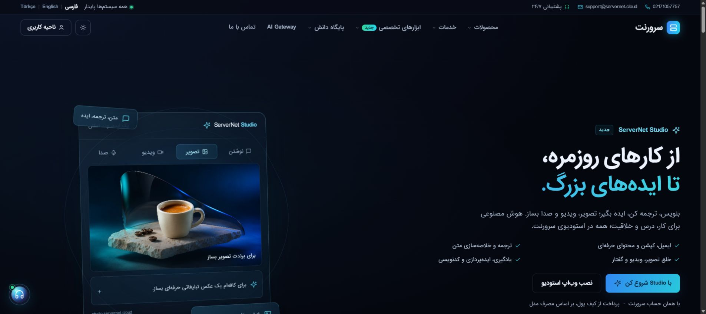
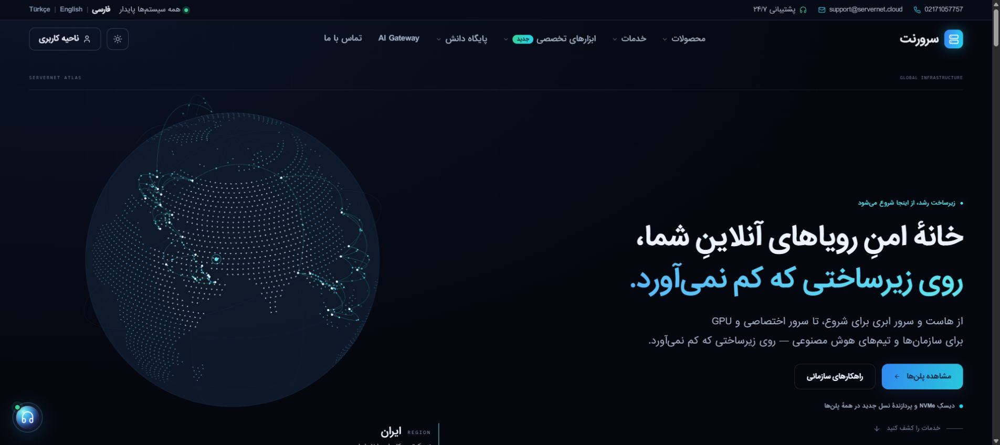

# ServerNet infrastructure / Studio carousel

Base: `develop@79f370d371cfe1a0a3d51fe3ed0868953490e11e`.

The original globe and infrastructure copy are the first frame on every visit. After seven seconds, a glass transition introduces ServerNet Studio in the same hero space. Its blue and cyan presentation uses consumer examples: emails and captions, translation and summaries, learning and brainstorming, and image, video and voice creation. A generated coffee campaign photograph makes the example concrete; it is labelled illustrative content. No preview calls inference.

The two selectors and pause/play control remain available. Selecting a slide or interacting with examples pauses rotation. Focus, hidden tabs, off-screen state and hovered controls pause the clock. Reduced motion starts with autoplay off and removes animations; visitors can select slides or request play. Hidden slides are inert and excluded from accessibility navigation. Grid overlap reserves the greater slide height. The original globe renderer and its region selection remain in place.

## Validation

PHP 8.4.27, isolated SQLite, locked dependencies: 14 relevant Laravel tests / 345 assertions passed. Twelve real-Blade DOM tests passed, including the initial infrastructure frame, seven-second transition, cycle, pause/resume with focus, hidden/off-screen behavior, reduced motion, local examples and script idempotence. Three isolated release tests cover live-only content preservation, concurrent edits and exact rollback. All ten workflow runs at source head `447fa5c` passed. The desktop scale follow-up at `87a62a3` passed its presentation workflow and four additional triggered regressions; its 12 DOM checks were also rerun locally successfully. A local DOM invocation initially lacked PHP on PATH; rerunning with the installed PHP 8.4.27 wrapper passed.

The design review is generated by `StudioHomePreview.php` and `build-preview.py`; only its globe canvas uses a static map. `review.html` provides real iframe widths of 320, 390 and 1280 CSS pixels, language and theme controls. Its optional `?live` mode points the same iframe at the actual public homepage. Temporary review files are public synthetic content with noindex metadata and are removed by their pinned hashes after acceptance.

## Limited release

Twelve destinations: eleven new dependencies and one guarded edit to the live home view. New partial, translation and asset names allow dependencies to install before the final home switch. The old Studio assets remain available for rollback and any already cached old HTML. The home patch preserves unrelated live-only differences and pins before/after hashes.

`scripts/studio-carousel-20261122/release.py` uses the shared release lock, private backup, complete preflight and atomic file replacements. Activation reuses pinned same-account socket helpers, compiles only three changed views and forgets only homepage cache keys. There is no global flush, migration, configuration or billing change. Rollback preflights every installed file and backup, restores the exact home view and dependencies, activates them, and retires only this release's new files. Any newer live edit stops rollback.

Image provenance: generated with the built-in image tool for this project. Prompt: “Premium photorealistic coffee campaign still life: ivory espresso cup, pale stone slab, smoked glass, midnight blue background and cyan/blue studio light; no text, logo, people or purple.” The original is retained; the website uses a 108,700-byte WebP encoding at `website/public/assets/img/studio-coffee-campaign.webp`.

## Production acceptance — 22 November 2026, 17:42 Tehran

PR [381](https://github.com/servernetir/server/pull/381) merged as `020840c8f49c94395c21b76338c8f231f00730e7` and installed all twelve destinations. PR [382](https://github.com/servernetir/server/pull/382) merged as `a1aaa833ca8c21d2fd4eb9a4f2859795cc276396` and installed the two CSS copies to cap the desktop glass scene at 560px. Both application FPM pools accepted targeted activation and confirmed Studio configured; neither release performed a general cache flush.

The live homepage source remains `c1993378b336c57291b1bd968529724c9d8802249bd6ddc73be493cccfa1de28`. Canonical `/`, `/en` and `/tr` returned 200 with both localized slides, infrastructure first, the 7000ms interval and no old standalone Studio assets. The public CSS, JS and image each returned 200 with their expected hashes:

| Asset | SHA-256 |
| --- | --- |
| `studio-carousel.css` | `b8668f9ff12980e7201773a0c6e30ac579b5b22eaf247aa8b4903076e63d322d` |
| `studio-carousel.js` | `658d15afd5bf3aeb06e9b46cddc5dfe95634fe180eb63dfdc0e8327b44c97042` |
| `studio-coffee-campaign.webp` | `b1c82519c349acbfdbdcec3919d0aed414c7dadc1ffd7d392290a92ce0f6821b` |

Chrome production acceptance observed the initial infrastructure slide, the running automatic clock and the subsequent Studio slide without manual selection. The actual globe canvas remains present. Manual selection paused rotation. At 1905 CSS pixels the live page had no horizontal overflow; the primary and secondary Studio actions were visible in the first viewport. The original larger infrastructure composition determines the shared slide height.

The synthetic real-Blade review checked Persian, English and Turkish at 320/390 widths, Turkish at 1280, and light/dark appearances. After production installation, the same review shell's `?live` mode loaded the actual public page; its 320/390 outer iframe widths yielded 305/375 content pixels after the scrollbar, with no horizontal overflow. This is iframe responsive acceptance, not a physical-device test. The committed synthetic previews represent PR 381; the final desktop size is evidenced by the production screenshots below.

Both temporary public review folders (`8ef8b318dc8a` and `447fa5cc124b`) were removed only after all five file hashes matched. No temporary activation folder remained. The main public homepage was left open with Studio selected for owner review; every new visit still starts on infrastructure.

## Exact rollback

Private stages and backups remain under `/home/servernetcloud/deploy-backups/studio-carousel-20261122-020840c8f49c/` and `/home/servernetcloud/deploy-backups/studio-carousel-fit-20261122-a1aaa833ca8c/`. To reverse this combined release, run the fit release's hash-guarded rollback first, then the original carousel release's rollback at their respective fixed merge SHAs. The fit rollback restores the original carousel CSS hash so the original release can preflight all twelve after-hashes. Any subsequent unrelated live edit stops the corresponding operation for review.

Status: installed and confirmed in production; source and acceptance evidence recorded in develop.
