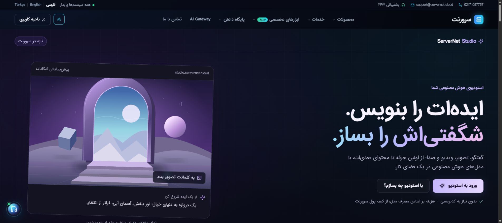

# ServerNet Studio homepage introduction

Base: `develop@38c1f391f534b6e35438f187a6197b7846890d69`.

The homepage introduces Studio before the infrastructure hero when central Studio access is configured. A purple and cyan composition explains chat, image, video and audio creation. Four local preview buttons show clearly labelled illustrative content and never request inference. The primary link opens the existing Studio; the installation link follows the locale to the existing web app guide. Shared account, wallet billing and model availability are explained without fixed model counts, prices or signed desktop installer claims.

Scope: one include in `pages/home.blade.php`, a new partial, three translations and three public assets. The SVG is an original conceptual illustration. Styles support RTL, small screens, light theme and reduced motion; ordinary buttons retain native keyboard navigation. Without JavaScript, the default illustration, capability descriptions and real links remain available.

## Validation

PHP 8.4.27 with locked Composer dependencies and synthetic SQLite: `StudioHomeHeroTest`, `StudioDownloadsTest`, `HomePricingPresentationTest` passed **14 tests / 328 assertions**. Four JavaScript DOM tests passed against real compiled Blade in fa/en/tr, covering preview switching, one visible panel, pressed state, localized installation links, the no-JavaScript initial state and zero inference requests. PHP syntax, JavaScript syntax, SVG XML and whitespace checks passed. The release helper has disposable-file tests for live-content preservation, rollback and refusal of concurrent edits.

The browser cannot access the executor's loopback preview. Public visual and responsive acceptance is recorded separately; DOM tests do not claim browser visual acceptance.

## Publication and rollback

`scripts/studio-home-20261122/manifest.json` pins eleven destinations: the partial, three translations, three assets in both the application public tree and actual document root, and the home view. The live homepage includes previously deployed changes absent from the checkout. Publication inserts only the new include into hash-pinned live bytes, preserving those differences. The prepared result has its own pinned after-hash. Dependencies install before the include.

The installer uses the shared release lock, complete preflight, private backup, atomic replacements, final hashes and a fixed reviewed commit. Activation reuses pinned same-account socket and HTTP-denial helpers, invalidates only release PHP and two compiled views, and forgets only homepage cache keys and front-controller aliases on the two canonical hosts. No general cache flush, migration, configuration, inference or financial change is involved.

On the approved application account: `python3 release.py prepare <sha>`, then `apply`, `verify` and `activate` with the same fixed SHA. Private receipt: `deploy-backups/studio-home-20261122-<sha12>/`. `rollback` with that SHA checks every installed hash and the backup before restoring the exact home bytes, recompiling the two views and retiring only this release's new files. Any newer live change stops rollback.

## Production acceptance — 22 November 2026

PR [378](https://github.com/servernetir/server/pull/378) reviewed source `2684232e3e972ac9b49e8574492293b22f08a793`, merged as `ecec7873c7a97ded3dab696d24785f2e048f3a11`. All ten triggered CI workflows completed successfully, including Studio presentation run `45026176616`, existing domain presentation, SEO and security regressions. Concurrent Ollama changes in develop were preserved.

Eleven runtime destinations installed and matched their manifest hashes. Both existing application FPM pools compiled the two views, reported Studio configured and confirmed no general cache flush. The original live-only home differences were preserved. Final public acceptance at **13:19:35 UTC / 16:49:35 Tehran** returned HTTP 200 with Studio present on `/`, `/en` and `/tr`; all three public assets matched source SHA-256. No temporary activation primary remained.

Live desktop acceptance: Persian RTL and English/Turkish LTR copy and localized guide links; purple/cyan composition in dark and light themes; all four previews switched to exactly one visible panel with the correct pressed state. The ordinary unparameterized Persian homepage shows Studio before the infrastructure hero. No browser console errors were observed in the final page. The viewport was 1920 CSS pixels with no horizontal overflow. The browser's requested mobile viewport override did not change its actual dimensions, so **live mobile visual acceptance remains unverified**. Responsive CSS and DOM checks are present; no narrow-browser screenshot or device test is claimed. The original dark theme and default viewport settings were restored.

Final status: source in develop, runtime installed and public desktop production acceptance confirmed. Rollback uses the fixed merge SHA above and the private receipt described earlier.
