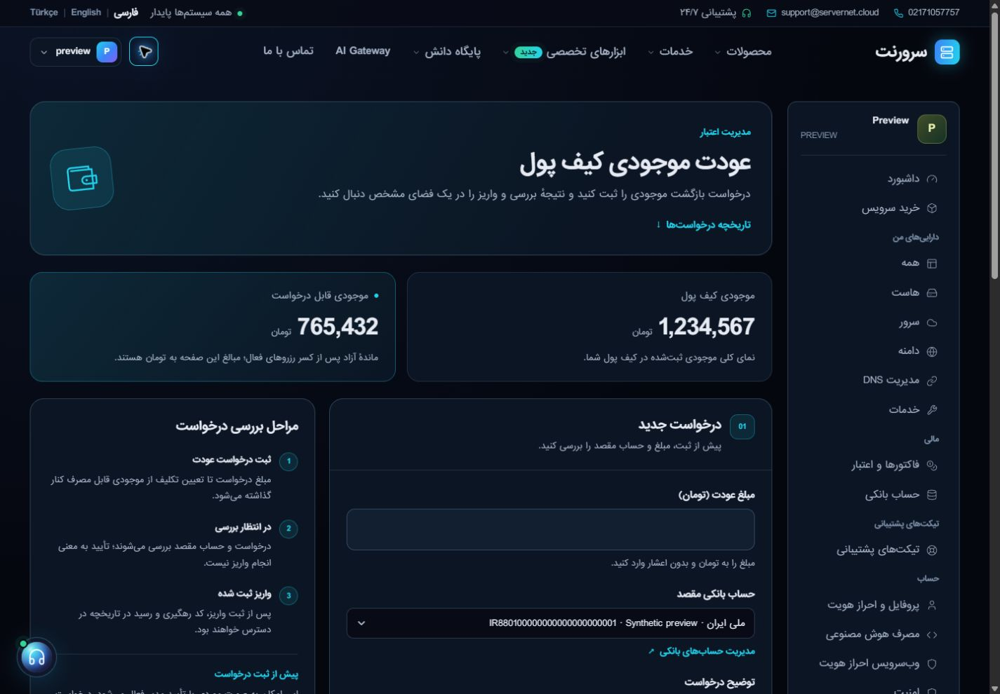

# نصب عودت کیف پول و منوی پنل — ۳۱ اکتبر ۲۰۲۶

**وضعیت: در تولید نصب شد؛ پذیرش نمایشی با رندر تولید و دادهٔ ساختگی تأیید شد.**

منبع ثابت، `develop` روی `8486b6fa5cc54145533d3d6b69678e5ddc03ea08` است؛ HEAD پیش از نصب دوباره خوانده شد و فایل‌های این بسته تغییر تازه‌ای نداشتند. بازطراحی عودت از PR181 / `345d454b` و اصلاح منو از PR149 / `9ef76035` آمده‌اند. این نوبت کد اجرایی محصول تازه‌ای طراحی نکرد؛ بستهٔ تأییدشده را با اختلاف‌های موجود تولید تطبیق داد.

نصب در **۱۳:۴۲:۲۰ تهران** (`10:12:20Z`) و فعال‌سازی وب در **۱۳:۴۳:۰۹ تهران** (`10:13:09Z`) ثبت شدند. تأیید نهایی هش‌ها و حذف helper فعال‌سازی در **۱۳:۵۲:۴۴ تهران** (`10:22:44Z`) انجام شد.

## دامنه و حفظ تغییرهای هم‌زمان

هشت فایل یکتای محصول در یازده مقصد نصب شدند؛ دو Blade نیز فقط در مسیر کامپایل خودشان بازسازی و lint شدند. [manifest بایت‌های واقعی پیش/پس](wallet-panel-live-manifest-20261031.json) مرجع تطبیق است.

| منبع در website | مقصد نسبت به home |
|---|---|
| resources/views/account/wallet-refunds.blade.php | servernet_app/resources/views/account/wallet-refunds.blade.php |
| lang/fa/refund.php، lang/en/refund.php، lang/tr/refund.php | سه مسیر متناظر زیر servernet_app/lang |
| resources/views/panel/layout.blade.php | servernet_app/resources/views/panel/layout.blade.php |
| public/assets/css/wallet-refunds.css | servernet_app/public/assets/css/wallet-refunds.css و public_html/assets/css/wallet-refunds.css |
| public/assets/css/panel.css | servernet_app/public/assets/css/panel.css و public_html/assets/css/panel.css |
| public/assets/js/panel-navigation.js | servernet_app/public/assets/js/panel-navigation.js و public_html/assets/js/panel-navigation.js |

دو کپی زندهٔ `panel.css` از پیش یکسان نبودند. فقط قواعد منو، پس‌زمینه، دکمهٔ بستن و reduced motion روی هر کدام ادغام شد؛ سایر تفاوت‌ها حفظ شدند. `@stack('panel-head')` موجود در layout زنده نیز حفظ شد. SHA-256 نهایی CSS عمومی `29a3dab6cdcd31e5481563f5264e1ee2758c28e40821ec2b123171a46a7aa05e` و کپی داخل app/public برابر `f3c130120803c16bd67ac5e595583f718e070ddf2d4fc408048261a30050434a` است.

هر دو قفل مشترک `.servernet-web-release.lock` و `servernet-release.lock` از پیش‌بررسی مرحلهٔ نصب تا پایان آن گرفته شدند. قبل از نوشتن هر مقصد، hash دوباره کنترل شد؛ فایل‌های همکار با نسخهٔ کامل develop جایگزین نشدند. پشتیبان خصوصی و قابل تطبیق در `/home/servernetcloud/wallet-panel-release-20261031/before/` و plan/رسیدهای نصب در همان پوشهٔ خصوصی نگه داشته شدند. checksum طرح انتقال `8ec3feafdfe7e92147e7b524bf688bf7817a78b5881a4d4432ef2afa848c32bf` است.

کنترلر، سرویس مالی، schema، route، تنظیمات، کرون و مجوزها جزو این انتشار نبودند. hash کرون پیش/پس یکسان بود. فایل‌های عمومی در هر دو مقصد app/public و document root نصب شدند؛ نصب داخل app/public به‌تنهایی موفقیت انتشار معرفی نشد.

## فعال‌سازی و پذیرش

فقط سه فایل ترجمه و دو Blade کامپایل‌شده در فعال‌سازی وب هدف بودند. مسیر موقت، middleware عادی `web`، `auth:web`، `admin` و CSRF را داشت؛ POST احرازشده، `activated=true` و `targets=5` داد. هیچ‌یک از این پنج مسیر هنگام فعال‌سازی bytecode کش‌شده نداشتند. cache مشترک برنامه، route و config پاک نشد.

- PHP **8.4.27**: روی سورس ثابت و سپس روی overlay مطابق نسخهٔ نصب‌شده، در هر اجرا **۷۶ تست / ۱۰۷۶ assertion** با صفر failure/error/skip موفق شدند. مجموعه شامل WalletRefundPresentationTest، WalletRefundWorkflowTest، AuditReportShareTest و ReportConsultationTest است؛ SQLite درون‌حافظه‌ای، mail/HTTP ساختگی و بدون اعتبارنامهٔ تولید. وابستگی‌های قفل‌شده و platform requirements بررسی شدند. اجرای نخست به‌دلیل نبود bcmath در runtime تست یک شکست داشت؛ extension هم‌نسخه به محیط ایزوله افزوده و اجرای نهایی کامل تکرار شد. تولید برای حل این محدودیت تغییر نکرد.
- مرورگر متصل، با **رندر واقعی تولید و مدل‌های ذخیره‌نشدهٔ ساختگی**: [۱۲ حالت](wallet-panel-live-acceptance-20261031.json)، حاصل fa/en/tr × روشن/تیره × عرض۳۹۰/۱۴۴۰، موفق بودند. عنوان/ترجمه، چهار کنترل required، CSRF، فرم POST، سطح سفید/تیره و نبود overflow کنترل شدند. خطای JavaScript ثبت‌شده در این پیش‌نمایش صفر بود.
- انتخاب‌گر بانک در مرورگر باز شد و listbox و گزینه‌های بومی دیده شدند. منوی موبایل با فوکوس روی دکمهٔ بستن باز شد؛ پس‌زمینه hit-test صحیح داشت، محتوای بیرون inert شد، Escape و کلیک پس‌زمینه آن را بستند و فوکوس به دکمهٔ منو برگشت.
- `/up` روی دو دامنه و شش پاسخ عمومی CSS/JS با hash مستقل بررسی شدند. helperهای فعال‌سازی و پیش‌نمایش پس از پذیرش با کنترل hash حذف شدند؛ HTTP404 هر دو مسیر نیز تأیید شد. [هر ۱۰ بررسی HTTP و hash](wallet-panel-http-acceptance-20261031.json) موفق بودند.

نشست مشتری هنگام پذیرش به صفحهٔ ورود برگشت؛ ادامهٔ پذیرش از پیش‌نمایش فقط‌مدیر با همان view و assetهای نصب‌شده انجام شد. داده‌های پیش‌نمایش در transaction فقط‌خواندنی و مدل‌های ذخیره‌نشده بودند؛ تصویر نیز فقط دادهٔ ساختگی دارد. ثبت درخواست واقعی عودت، لغو درخواست مشتری و واریز انجام نشدند. ۱۱۱ حالت مرورگر گزارش توسعهٔ قبلی به‌عنوان اجرای تازهٔ این نوبت شمارش نمی‌شوند.

## بازگشت و ابزارهای موقت

ابزار نصب در [deploy-wallet-panel-20261031.py](../../scripts/deploy-wallet-panel-20261031.py) و سورس پیش‌نمایش موقت در [wallet-panel-preview-20261031.php](../../scripts/wallet-panel-preview-20261031.php) ثبت شده‌اند؛ این دو فایل مقصد دائمی وب نیستند. اسکریپت نصب بدون plan خصوصی و checksum معتبر اجرا نمی‌شود و نصب تکراری را رد می‌کند.

بازگشت فقط پس از گرفتن همان دو قفل و تطبیق hash فعلی با `after_sha256` همین رسید انجام شود: نسخهٔ قبلی همین مقصدها از before برگردد، دو Blade دوباره compile/lint شوند و فقط پنج مسیر PHP مرتبط در وب فعال شوند. اختلاف تازهٔ هر مقصد نیازمند تطبیق است. asset تازه تا بررسی نبود مصرف‌کنندهٔ جدید حذف نشود. بازگرداندن کل اپ، cache عمومی یا دادهٔ مشتری بخشی از بازگشت این بسته نیست.
